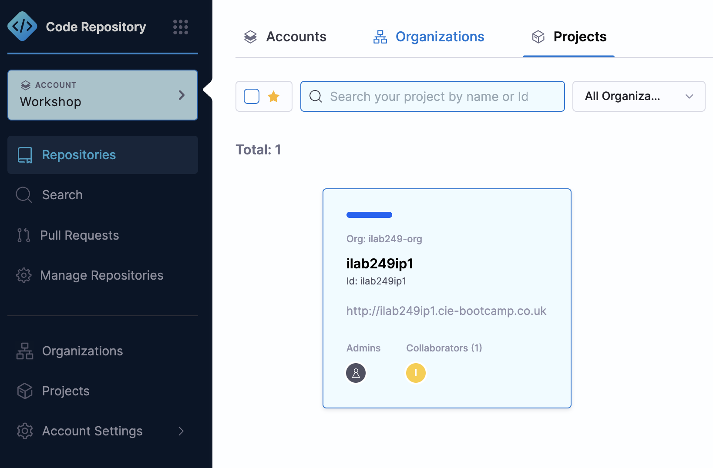
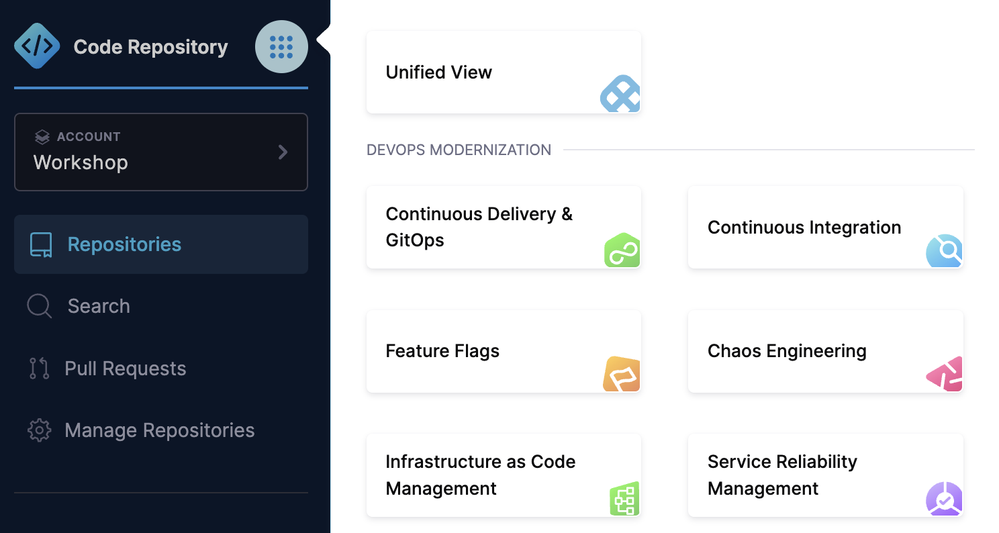

# Workshop Primer

Two Harness navigation patterns come up in every lab. Skim them now so the labs can stay focused.

## Finding your project

1. From the left-hand side menu, click on **Account**
2. From the top navigation bar, select **Projects**
3. Click the desired project; everything will be scoped to that project

## Switching Harness modules

You will switch between modules several times during the workshop - CI/CD, Database DevOps and AI Agents.

1. Click on the **nine dot** menu icon
2. Select the module relevant to the step

Each lab tells you when to switch. Part 1 begins in the CI/CD module. Part 2 stays on the same `workshop` pipeline and switches to Database DevOps only when editing the changelog or Overview.

## Environment values and preflight checks

The labs were written against a reference workshop environment. The values below are the ones that can differ in yours. Check them before Lab 1; if one differs, substitute your value everywhere that row's labs use it.

| Value shown in labs | Used in | What it must be | Preflight check |
| --- | --- | --- | --- |
| `harness-devsecops` | Labs 1, 3 | The Git repository holding the sample application (this repo's `frontend-app/`, `backend/`, `harness-deploy/`, `automation/`, `python-tests/`) | Open the Code Repository module: the repo exists and contains those folders. If yours has a different name, use it in Lab 1 Step 2 and Lab 3 Step 2 |
| `workshop` HAR registry | Labs 1, 3 | A project-scoped Docker **Harness Artifact Registry** named `workshop` | Artifact Registries lists `workshop`; Lab 1 pushes image `harness-workshop` into it. Organisers pre-create this per project - see [`reference/ORGANISER-SETUP.md`](../reference/ORGANISER-SETUP.md) |
| `harness-workshop` image | Labs 1, 3 | Image repository name inside the HAR registry | Same string in Lab 1 (Image Name) and Lab 3 (Image Path) |
| `username` pipeline / project variable | Labs 1, 3, 6 | Used in image tags and the smoke-test hostname (`<+variable.username>-<+pipeline.sequenceId>`) | Project variable `username` usually already exists in the event setup; otherwise add it. Tag expression must match in Labs 1 and 3 |
| `prod` environment, `k8s` infrastructure | Labs 3-5 | The deployment target for the sample application | Project Settings > Environments shows `prod` with the `k8s` infrastructure definition |
| `lab_endpoint` project variable | Labs 4, 5 | The sample application's URL | Project Settings > Variables shows `lab_endpoint` after the first deployment |
| `DB` schema, `DB3` instance | Labs 6-9 | Production database used by the merged pipeline (DB1/DB2 exist but are unused in this lighter design) | Database DevOps > Overview lists DB3 |
| `db_changes` repository | Labs 6-9 | Git repo whose `changelog.yaml` triggers the **workshop** pipeline; starts from [`db/changelog.yaml`](../db/changelog.yaml) | Code Repository module shows `db_changes` with a `changelog.yaml` at its root |
| `k8s-db` cluster | Labs 6-9, 14 | Kubernetes connector for containerized DB steps | Must pass connection test. Do **not** use `k8s-prod` for DB steps in this workshop |
| `servicenow` connector, ven03172.service-now.com | Labs 11-15 | The project-level ServiceNow connector and sandbox | Project Settings > Connectors lists `servicenow`; your instructor provides the sandbox credentials |
| `account.harnessAnthropic` model connector | Lab 14 | The Harness-managed model connector for the Failure Analyst agent | No setup needed; it is account-managed |

The templates, policies, policy sets and the Failure Analyst agent the labs reference are listed in the [README](../README.md#what-is-pre-provisioned-for-you); confirm they exist in Project Settings before Part 3.

---

Next: [Lab 1: Build](01-build.md)
