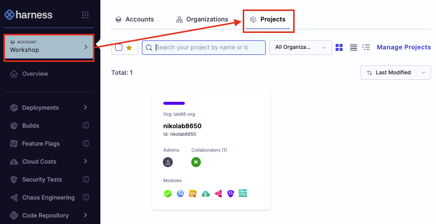

# Lab 1: Build

## Key Outcomes
- Configure a basic CI pipeline  
- Build and push artifacts to a remote repository  
- Run unit tests to verify build success  

## Overview
In this lab, the user sets up a CI pipeline that runs source code tests, builds the executable, and pushes the artifact to Harness Artifact Registry (HAR). This establishes the foundation for a deployable artifact that can be promoted through environments.

---

## Walkthrough

### Step 1: Create a Pipeline
1. In the Harness UI, from the left-hand menu, navigate to **Projects** and select your assigned project

2. From the left-hand side menu, select **Pipelines**
3. Click **+ Create a Pipeline**, enter the following values, then click **Start**

| Input      | Value     | Notes |
| ---------- | ----------------------  | ----- |
| Name       | <pre>`workshop`</pre>||
| How do you want to setup your pipeline | Inline | This indicates that Harness (rather than Git) will be the source of truth for the pipeline |

---

### Step 2: Add a Build Stage
1. From Pipeline Studio, click **Add Stage** and select **Build** as the Stage Type
2. Enter the following values and click on **Set Up Stage**

| Input      | Value     | Notes |
| ---------- | ----------------------  | ----- |
| Stage Name | <pre>`Build`</pre>||
| Clone Codebase | Enabled ||
| Repository Name | <pre>`harness-devsecops`</pre>||

---

### Step 3: Configure Infrastructure
1. Navigate to the **Infrastructure** tab
2. Configure as follows:

| Input      | Value     | Notes |
| ---------- | ----------------------  | ----- |
| Infrastructure | Cloud ||

---

### Step 4: Configure Execution Steps
Navigate to the **Execution** tab and add the following steps:

**Test Intelligence Step**
1. Click **Add Step**, then **Add Step** again
2. Select **Test Intelligence** from the Step Library

| Input      | Value     | Notes |
| ---------- | ----------------------  | ----- |
| Name | <pre>`Run Tests With Intelligence`</pre>||
| Command | <pre>`pip install pytest && cd ./python-tests`</pre>| The GitHub repo is a monorepo with application(s) and configuration in the same repo. Therefore we need to navigate to the application subfolder. |

3. Click **Apply Changes**

**Compile Application (Template)**
1. Click **Add Step**, then **Use Template**
2. Select the **Compile Application** template

| Input      | Value     | Notes |
| ---------- | ----------------------  | ----- |
| Name | <pre>`Compile`</pre>||

3. Click **Apply Changes**

**Build and Push to Harness Artifact Registry**
1. Click **Add Step**, then **Add Step** again
2. Select **Build and Push an image to Docker Registry** from the Step Library

| Input      | Value     | Notes |
| ---------- | ----------------------  | ----- |
| Name | <pre>`Push to HAR`</pre>||
| Registry Type | Harness Artifact Registry | Leave the default (do **not** switch to Third-Party / Docker Hub) |
| Registry | <pre>`workshop`</pre> | Pre-provisioned Docker HAR registry in your project (organiser setup). No Docker connector needed |
| Image Name / Repository | <pre>`harness-workshop`</pre> | Image repository inside the HAR registry |
| Tags | <pre>`<+variable.username>-<+pipeline.sequenceId>`</pre>| Click **+ Add** to add a tag row, then click the pin on that row, select **Expression** and paste the value |
| **Optional Configuration** |||
| Dockerfile | <pre>`/harness/frontend-app/harness-webapp/Dockerfile`</pre>| This tells Harness where the Dockerfile is for building the app |
| Context | <pre>`/harness/frontend-app/harness-webapp`</pre>| This tells from where to run the instructions included in the Dockerfile |

3. Click **Apply Changes**

> YAML shape (for catch-up): `type: BuildAndPushDockerRegistry` with `spec.registryRef: workshop` and `spec.repo: harness-workshop` — use **`registryRef`**, not `connectorRef`. Full pipeline: [`reference/workshop-pipeline.yaml`](../reference/workshop-pipeline.yaml).

---

### Step 5: Save and Test the Pipeline
1. Click **Save** to finalize the pipeline
2. Click **Run** to manually execute it

| Input      | Value     | Notes |
| ---------- | ----------------------  | ----- |
| Branch Name | <pre>`main`</pre>| Not prefilled. Type `main` |

> [!WARNING]
> Pipeline execution is rejected by the policy engine. Let's create a compliant pipeline.
> Proceed to Lab 2: DevSecOps.
