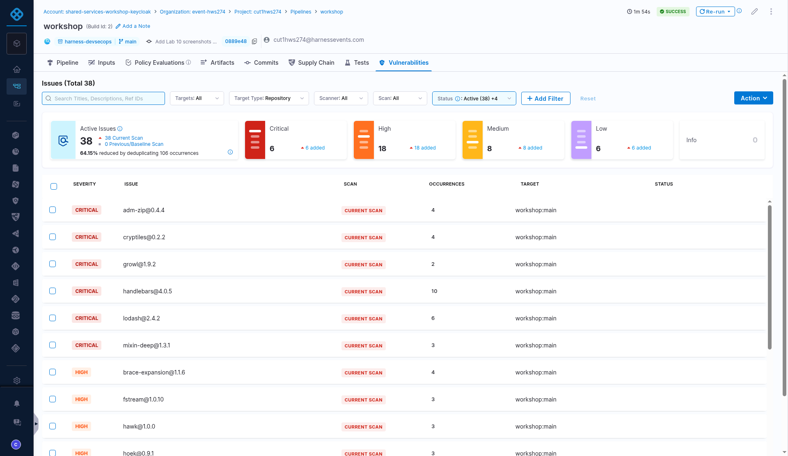
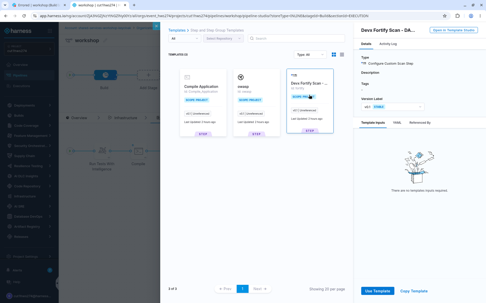

# Lab 2: DevSecOps

## Key Outcomes
- Understand how governance plays a role in the path to production  
- Leverage reusable templates to standardize security scanning  
- Achieve DevSecOps practices with minimal developer friction  

## Overview
In this lab, the security team has implemented orchestration of **Fortify** and **OWASP** scans in reusable templates. Policies enforce the inclusion of these templates in all pipelines, ensuring security scans are always executed before deployment.

---

## Walkthrough

### Step 1: Add Security Scanning Steps
1. In the existing pipeline, within the **Build** stage, **before** the **Push to DockerHub** step, click the **+** icon to add a new step
2. Select **Use Template**

3. Select **Devx Fortify Scan - DAST**

| Input      | Value     | Notes |
| ---------- | ----------------------  | ----- |
| Name | <pre>`Fortify`</pre>||

4. Click **Apply Changes**

---

### Step 2: Add OWASP Scan
1. In the existing pipeline, within the **Build** stage, **after** the **Push to DockerHub** step, click the **+** icon to add a new step
2. Select **Use Template**
3. Select **OWASP**

| Input      | Value     | Notes |
| ---------- | ----------------------  | ----- |
| Name | <pre>`OWASP`</pre>||

4. Click **Apply Changes**

---

### Step 3: Run the Pipeline
1. Click **Save** and then **Run** to execute the pipeline

| Input      | Value     | Notes |
| ---------- | ----------------------  | ----- |
| Branch Name | <pre>`main`</pre>| Not prefilled. Type `main` |

2. After the **Build and Push** stage is complete, navigate to the **Vulnerabilities** tab (formerly **Security Tests**) to see the deduplicated, normalized, and prioritized list of vulnerabilities discovered across your scanners. The tab is available while the run is in progress, and it can show 0 for a few seconds before the results load

> [!TIP]
> The execution page doesn't always update on its own. If a step looks stuck, refresh the page.

---

## Value Callouts

| Aspect | Description |
| :--- | :--- |
| **Shift Left Security** | Security scans run during the build phase, catching vulnerabilities before deployment. |
| **Template Reusability** | Security steps are defined once and reused across all pipelines, ensuring consistency. |
| **Policy Enforcement** | Governance policies ensure security scans cannot be skipped. |
| **Unified View** | All vulnerabilities are deduplicated and prioritized in a single dashboard. |
