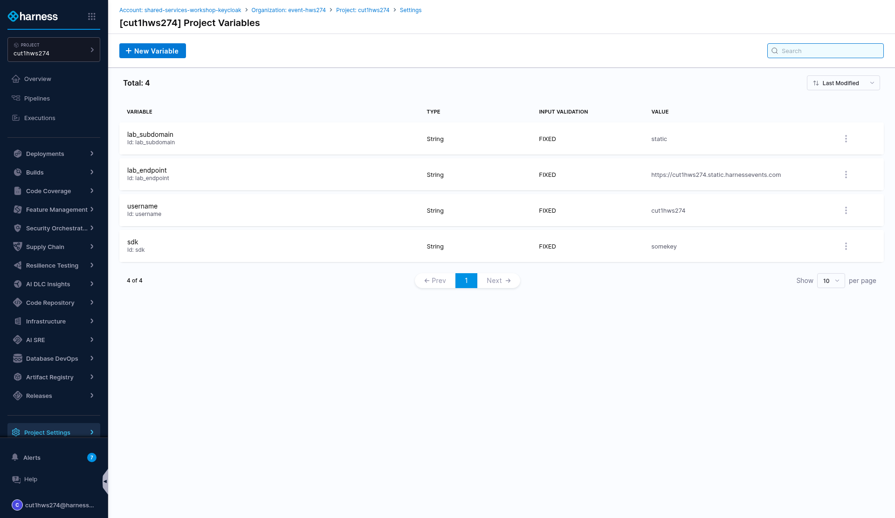
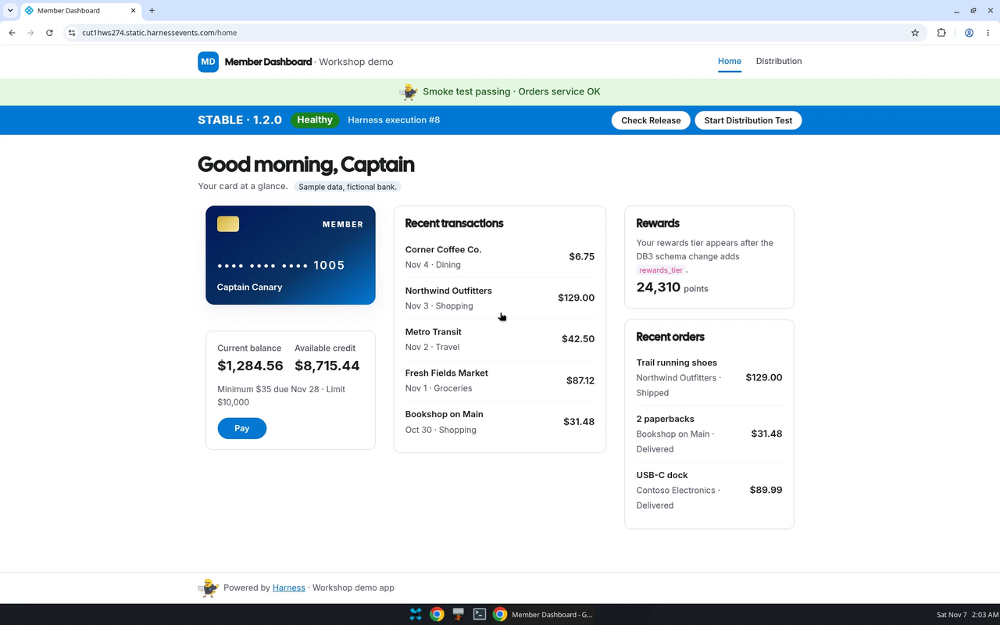

# Lab 4: Continuous Deploy - Backend

## Key Outcomes
- Utilize complex deployment strategies to reduce blast radius  
- Implement approval gates for production deployments  

## Overview
In this lab, the user adds a backend deployment stage using a canary deployment strategy with a manual approval gate and AI-driven continuous verification to minimize risk during production releases.

---

## Walkthrough

### Step 1: Add Backend Deployment Stage
1. In the existing pipeline, click **Add Stage** and select **Deploy** as the Stage Type
2. Enter the following values and click **Set Up Stage**

| Input      | Value     | Notes |
| ---------- | ----------------------  | ----- |
| Stage Name | <pre>`backend`</pre>||
| Deployment Type | Kubernetes ||

---

### Step 2: Configure Service
1. Click **- Select -** on the **Select Service** input box
2. Select **backend**

| Input      | Value     | Notes |
| ---------- | ----------------------  | ----- |
| Name | <pre>`backend`</pre>||

3. Click **Apply Selected** and then click **Continue**

---

### Step 3: Configure Environment
The target infrastructure has been pre-created and was used in the previous stage. To reuse the same environment:

1. Click **- Propagate Environment From**
2. Select **Stage [frontend]**
3. Click **Continue**

---

### Step 4: Configure Canary Deployment
1. Select **Canary** and click **Use Strategy**
2. **After** the canary deployment and **before** the canary delete step, add a **Harness Approval** step

| Input      | Value     | Notes |
| ---------- | ----------------------  | ----- |
| Name | <pre>`Approval`</pre>||
| User Groups | All Project Users | Open the **Project** tab to see the "All Project Users" option |

> [!NOTE]
> The step library lists this step as **Harness Approval**, but the step panel is titled **Manual Approval**. They are the same step.

3. Click **Apply Changes**

---

### Step 5: Save and Run
1. Click **Save** and then click **Run** to execute the pipeline

| Input      | Value     | Notes |
| ---------- | ----------------------  | ----- |
| Branch Name | <pre>`main`</pre>| Not prefilled. Type `main` |
| Primary Artifact | <pre>`backend`</pre>| Select it on the run form if it isn't already set |

2. While the canary deployment is ongoing and waiting for approval, navigate to the web page and see if you can spot the canary (use the **Check Release** button). The button calls the backend on a separate host, `<username>.backend.<lab_subdomain>.harnessevents.com`. If your browser shows a certificate warning for it, open that host in a new tab once and accept the warning. Even then, the **Last Execution** box may stay blank
3. From the left-hand side menu, navigate to **Project Settings**
4. Select **project variables**
5. The URL is in the **lab_endpoint** variable.

---

### Step 6: Add continuous verification alongside the approval
1. Edit the existing pipeline
2. Select the backend stage and find the **Harness Approval** step between the Canary Deployment and Canary Delete steps. Keep it
3. **After** the canary deployment and **before** the **Approval** step, add an **AI Verify (v1)** step. The step library no longer has a plain **Verify** step

| Input      | Value     | Notes |
| ---------- | ----------------------  | ----- |
| Name | <pre>`Verify`</pre>||
| Continuous Verification Type | Canary ||
| Duration | 5 min ||

The backend stage now runs Canary Deployment, then **Verify**, then **Approval**, then Canary Delete. Verify checks the canary's metrics first, and a person signs off only once they pass.

4. Click **Save** and then click **Run** to execute the pipeline

| Branch Name | <pre>`main`</pre>| Not prefilled. Type `main` |
| Primary Artifact | <pre>`backend`</pre>||

> [!TIP]
> The execution page doesn't always update on its own. If a step looks stuck, refresh the page.

---

## Value Callouts

| Aspect | Description |
| :--- | :--- |
| **Progressive Delivery** | Canary deployments reduce risk by gradually rolling out changes. |
| **Manual Gates** | Approval steps ensure human oversight for critical deployments. |
| **AI Verification** | AI Verify checks canary metrics before anyone is asked to approve. |
| **Environment Propagation** | Reusing environments across stages reduces configuration duplication. |
