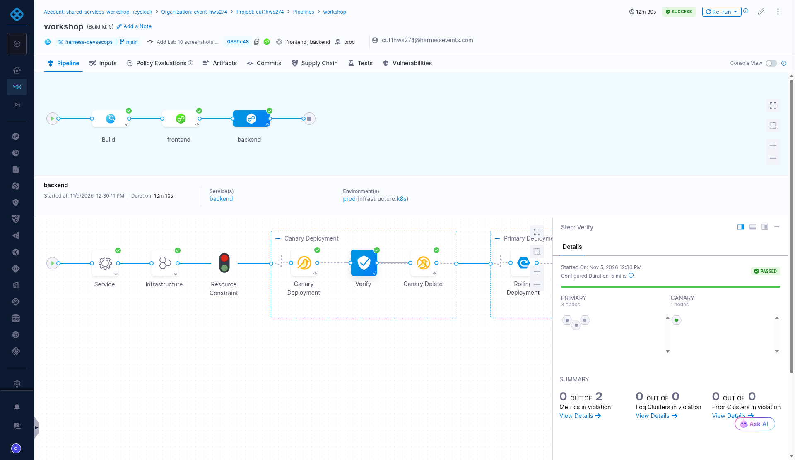
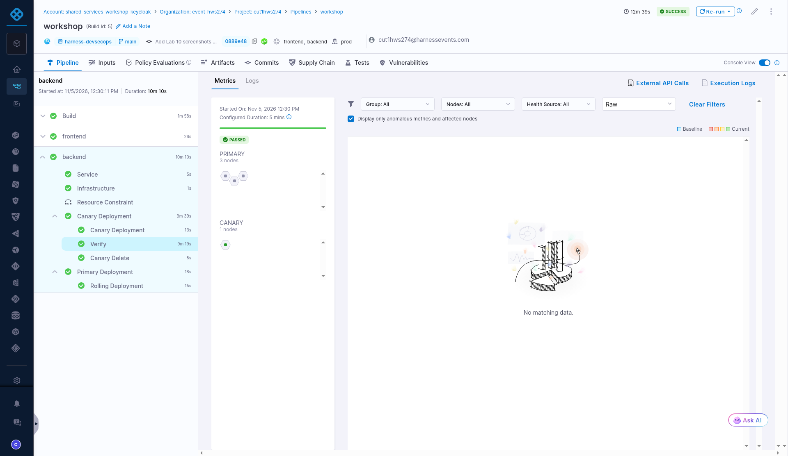

# Lab 5: Validate the Release

## Key Outcomes
- Identify traffic differences between stable and canary instances  
- Automate release validation  

## Overview
In this lab, the user validates canary deployments by observing traffic distribution and monitoring application behavior during progressive rollouts.

---

## Walkthrough

### Step 1: Observe Canary Traffic
1. While the canary deployment is ongoing, navigate to the web page. The URL is in the **lab_endpoint** project variable, as in Lab 4
2. Open the **Distribution** tab (or click **Start Distribution Test** in the release bar on Home)
3. Click **Start test** to send synthetic traffic. The page sends 4 requests per second for up to 10 minutes; **Stop test** and **Reset** are next to it
4. Observe the traffic distribution between canary and stable instances: the **Stable** and **Canary** totals show each tier's share and build, and the chart shows requests per second over the last 60 seconds
5. Set **Compare against** to the canary share you expect. It is only a reference and doesn't change routing. With the default Canary step (1 canary pod next to 3 stable pods) that is about 25%. The page says whether the observed share is within 5 points of it. If every request fails, open the backend URL once in a new tab to accept its certificate, then start again

---

### Step 2: Validate Pipeline Execution
1. Return to the pipeline execution in Harness
2. Validate the outcome of the verification step
3. Observe how Harness automatically evaluates metrics during the canary phase

---

### Bonus Activities
- If verification fails, Harness defaults to manual intervention. Decide what happens next (rollback, ignore, etc.). Lab 13 rolls a failed release back automatically
- Add a canary rollout from 10% to 50% traffic and observe how this impacts traffic distribution

---

## Value Callouts

| Aspect | Description |
| :--- | :--- |
| **Automated Validation** | Harness validates deployments automatically, reducing manual testing. |
| **Traffic Shaping** | Canary deployments allow controlled traffic distribution for risk mitigation. |
