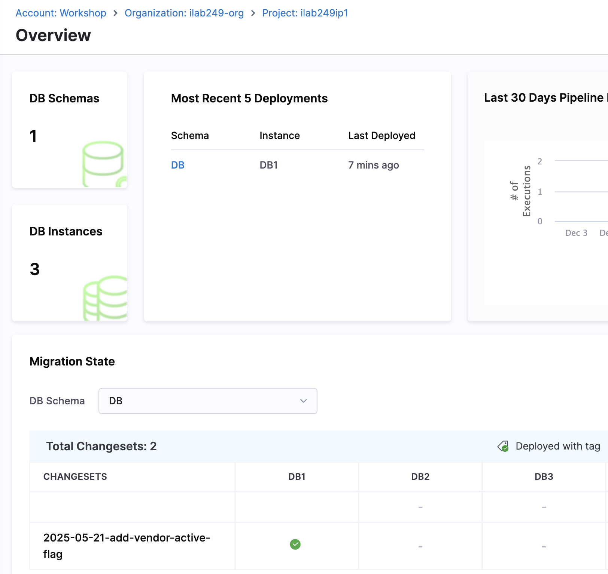

# Lab 6: Database DevOps - Deploy a Change

## Key Outcomes
- No friction for developers  
- Automated changes  

## Overview
In this lab, the user sets up a pipeline integrating a schema source, a target database, change application steps, and built-in change management.  
The user then pushes a new database changelog to Git (e.g., adding a column). This triggers the pipeline and creates a pull request review step for the database change, just like any other code change.

---

## Walkthrough

### Step 1: Create a Deployment Pipeline
1. In the Harness UI, navigate to the **Database DevOps** module
2. From the left menu, select **Pipelines**.  
3. Click **Create a Pipeline**, enter a name

| Input      | Value     | Notes |
| ---------- | ----------------------  | ----- |
| Name       | <pre>`Deploy DB Schema`</pre>||
| Setup |Inline||

4. Click **Start**.  
5. Click **Add Stage** and choose **Custom Stage**

| Input      | Value     | Notes |
| ---------- | ----------------------  | ----- |
| Stage Name | <pre>`Deploy Dev`</pre>||


6. Click **Add Step** and select **Add Step Group**

| Input      | Value     | Notes |
| ---------- | ----------------------  | ----- |
| Name       | <pre>`DB`</pre>||
| Enable     | Containerized Execution||
| Kubernetes Cluster | k8s-db || 


---

### Step 2: Add the Schema Deployment Step
1. Inside the step group, click **Add Step**.
2. From the available out-of-the-box steps, select **Apply Schema**
3. Configure accordingly


| Input      | Value     | Notes |
| ---------- | ----------------------  | ----- |
| Name       | <pre>`Schema Apply`</pre>||
| Select DB Schema     | DB||
| Database Instance | DB1 || 

4. Click **Apply Changes**.

---

### Step 3: Save and Test the Pipeline
1. Click **Save** to finalize the pipeline.  
2. Click **Run** to manually execute it.  

Verify that:
- The schema changes are applied to the target database.
- The pipeline completes successfully.

#### Verify changes
1. From the left menu, select **Overview**
2. The changes should be visible for **DB1**




---

### Step 4: Enable Automatic Git-Based Deployment
1. While in the pipeline studio, use the top right navigation bar
2. Click **Triggers**, then **New Trigger**.  
3. Choose **Harness** as the trigger type.

| Input      | Value     | Notes |
| ---------- | ----------------------  | ----- |
| Name       | <pre>`Update`</pre>||
| Repository | db_changes||
| Event      | Push ||

4. Click **Continue**
5. Under **Conditions**

| Input      | Operator     | Value |
| ---------- | --------- | ----------------------  |
| Branch name(s)       | Equals | <pre>`main`</pre>|
| Changed File | Equals | <pre>`changelog.yaml`</pre>|

6. Click **Continue**, then **Create Trigger**.

---

### Step 5: Push a Changelog to Git
1. Navigate to **Code Repository Module**.  
2. Click into repo **db_changes**.  
3. Click the **Edit** button.  

In your configured Git repo, add a changeSet **after the existing changeset** to introduce a new change:

```yaml
  - changeSet:
     id: add-second-email-column
     author: harness-lab
     changes:
       - addColumn:
           tableName: users
           columns:
             - column:
                 name: second_email
                 type: varchar(255)
                 constraints:
                   nullable: true
```


The pipeline will automatically trigger:
The schema change will be applied to the target database.

### Value Callouts
| Aspect | Description |
| :--- | :--- |
| **Familiar Workflow** | Developers stay in Git. |
| **Single Source of Truth** | All changes are versioned together. |
| **Lower Learning Curve** | GitOps-aligned workflows. |
| **Accelerated Velocity** | No manual DB scripts or tickets. |
| **Compliance by Design** | Automated, policy-driven changes. |
