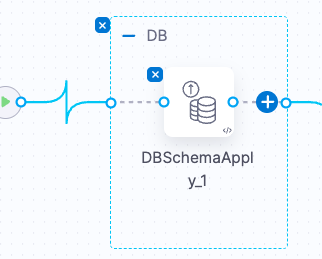

# Lab 7: Database DevOps - Roll Back a Change

## Key Outcomes
- Safe failure handling  
- Pre-validated rollback plans  
- Confidence in change velocity  

---

## Overview
In this lab, the user intentionally deploys a database changelog that introduces a breaking or invalid change (for example, dropping a required column). The pipeline detects the failure during deployment to a non-production environment and automatically triggers a rollback using a predefined backout script.

This simulates a real-world scenario where a change fails validation or breaks application behavior, and highlights how Harness enables fast recovery without manual intervention or firefighting.

---

## Walkthrough

### Step 1: Add a Rollback Step
1. Navigate to your pipeline and locate the step group containing your **Schema Apply** step.  
2. Hover to the right of the **Schema Apply** step and click the **➕** icon to add a new step to the right of the existing step.



   
3. From the list of steps find and select the **Rollback Schema** step.
4. Configure accordingly:

| Input      | Value     | Notes |
| ---------- | ----------------------  | ----- |
| Name       | <pre>`Schema Rollback`</pre>||
| Select DB Schema     | DB||
| Select DB Instance | DB1 || 
| Rollback Count | <pre>`1`</pre>||


**Add Conditional Execution**
1. Within the same step configuration, scroll to the top
2. From the navigation bar, select **Advanced** 
3. Click **Conditional Execution**.  
4. Choose **If the previous step fails**.  
5. Click **Apply Changes**, then **Save** the pipeline.

---

### Step 2: Push a Breaking Change to Git
In your configured Git repository, add a changeSet that attempts to make an invalid change:

```yaml
  - changeSet:
     id: add-duplicate-column
     author: harness-lab
     changes:
       - addColumn:
           tableName: users
           columns:
             - column:
                 name: id
                 type: int
                 constraints:
     rollback:
       - sql:
           comment: This is a no-op rollback for the invalid column addition.
           sql: SELECT 1;
```


Commit and push the change to the main branch.

## Result

The pipeline will automatically trigger:
1. The breaking change will attempt to apply and fail. **Can you identify why?**
2. The rollback plan will be executed automatically.
3. The environment will be restored to a stable state.
4. Navigate to **Overview** under the Database DevOps module and review the change sets versions and status

## Value Callouts

| Aspect | Description |
| :--- | :--- |
| **Automatic Rollbacks** | Backout plans are pre-validated and ready to run, reducing mean time to recovery (MTTR) |
| **No Manual Intervention:** | Developers do not need to SSH into environments or locate old scripts - rollback is built into the pipeline. |
| **Resilience as Default** | Pipelines are designed to fail gracefully, keeping environments stable and deploy-ready. |
