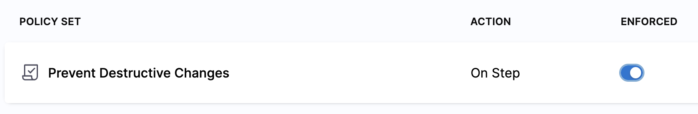
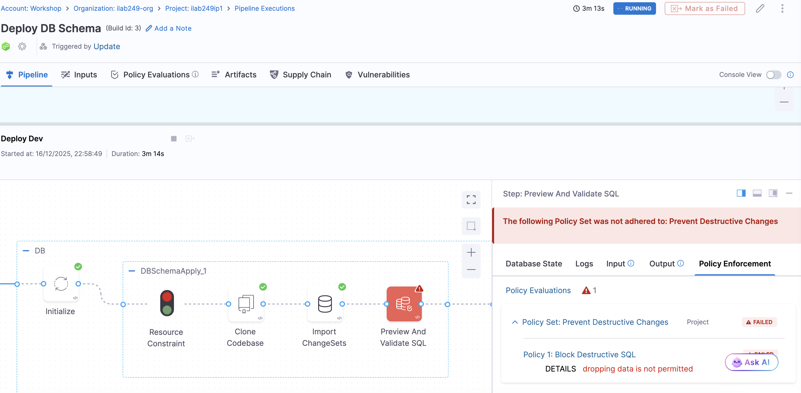

# Lab 8: Database DevOps - Enforce Governance and Policy

## Key Outcomes

* Targeted **policy-as-code** enforcement
* Standardized review and **approval gates**
* **Risk mitigation** before deployment

---

## Overview

In this lab, the user attempts to push a database changelog that **drops a table**—an action disallowed in this environment. The pipeline evaluates the change using integrated policy-as-code (OPA) rules and immediately blocks execution.

The user reviews the policy failure, understands the violation, and updates the changelog to meet organizational standards before resubmitting.

---

## Walkthrough

### Step 1: Create a Policy

1.  In the left-hand panel, go to **Project Settings**.
2.  Select **Policies**, then click **New Policy**.
    > You may have to click the **X** in the upper right to dismiss a pop-up.

| Input      | Value     | Notes |
| ---------- | ----------------------  | ----- |
| Name       | <pre>`Block Destructive SQL`</pre>||

3. Let's block **dropping data**
4. Copy the REGO code below into the policy editor

```opa
package db_sql

rules := [
  {
    "types": ["mssql","oracle","postgres","mysql"],
    "environments": ["prod"],
    "regex": [
      "drop\\s+table",
      "drop\\s+column",
      "drop\\s+database",
      "drop\\s+schema"
    ]
  },{
    "types": ["oracle"],
    "environments": ["prod"],
    "regex": ["drop\\s+catalog"]
  }
]

deny[msg] {
  some i, k, l
  rule := rules[i]
  regex.match(concat("",[".*",rule.regex[k],".*"]), lower(input.sqlStatements[l]))
  msg := "dropping data is not permitted"
}
```

5. Click **Save**

   
### Step 2: Create a Policy Set and Enforce in Pipeline

1. From the top right navigation bar click **Policy Sets**
2. Click **+ New Policy Set**

| Input      | Value     | Notes |
| ---------- | ----------------------  | ----- |
| Name       | <pre>`Prevent Destructive Changes`</pre>||
| Entity Type | Custom ||
| On what event | On Step || 
  
3. Click **Continue**.
4. Under Policy to Evaluate, click **Add Policy**.
5. Select the **Block Destructive SQL** policy.
6. Click **Apply**, then **Finish**.
7. Toggle **Enforce**.



**Add the policy set in the pipeline**

1. Navigate to the pipeline studio (in edit mode)
2. Open the **Apply Change** step
3. Within the step configuration and from the top navigation bar select **Advanced**
4. Expand the **Policy Enforcement** section
5. Click on **Add/Modify Policy Set**
6. From the navigation bar select your project
7. Select the **Prevent Destructive Changes** policy set
8. Click **Apply Changes**
9. **Save Pipeline**
    
> The new Policy Set is now active and linked to the pipeline runtime.

### Step 3: Push a Disallowed Change to Git

1.  In your configured Git repo, add a **changeSet** that violates the policy (attempting to drop a table):

  ```yaml
    - changeSet:
        id: 2025-05-21-drop-users-table
        author: harness-lab
        changes:
          - dropTable:
              tableName: users
  ```

2.  Commit and push the change to the monitored branch (main).
3.  Notice that the changeset attempts to drop the **users** table


#### Pipeline Observation

The pipeline will automatically trigger. Observe that:

* The policy is triggered as part of the pipeline execution.
* The execution fails before deployment.
* The pipeline halts with the error:
    > dropping data is not permitted

Review pipeline output and logs



---

## Value Callouts

| Aspect | Description |
| :--- | :--- |
| **Guardrails, Not Roadblocks** | Policies surface issues early without slowing down developers who follow best practices. |
| **Standardized Governance** | Approval workflows and checks are consistent across teams, environments, and databases. |
| **Policy-as-Code** | Governance is defined in code and version-controlled—just like everything else. |
| **Risk Reduction** | Disallowed or unsafe changes are caught before they affect production. |
| **Scalable Compliance** | Teams can move fast while meeting security and audit requirements at scale. |
