# Lab 11: Change Management with ServiceNow

## Key Outcomes
- Enforce a change approval gate with Policy as Code
- Automatically raise a ServiceNow change request populated with pipeline metadata
- Gate production deployments on a ServiceNow approval
- Close the change request automatically once the release succeeds

## Overview
In regulated environments you can't ship to production without following change policy and keeping an audit trail. In this lab the user enforces a policy that requires an approval stage before any deployment, then uses enterprise-approved templates so the pipeline raises, waits on and closes ServiceNow change requests by itself. Compliance as code, not compliance as a bottleneck.

---

## Walkthrough

### Step 1: Review the Approval Required Policy
1. From the secondary menu, select **Project Settings** and select **Policies**
2. Select the **Policies** tab, open **Approval Required Policy** and review the rego. It denies any pipeline where a **Deployment** stage is not preceded by an **Approval** stage
3. Click **Select Input** on the right and select the following values

| Input      | Value     | Notes |
| ---------- | ----------------------  | ----- |
| Entity Type | Pipeline ||
| Organization | \<your org\> ||
| Project | \<your project\> ||
| Action | On Save ||

4. Select your most recent pipeline save, click **Apply** and then click **Test**. What do you think will happen?

> [!NOTE]
> Lab 10 required a Harness Approval step **inside** each deployment stage. Change policy goes further and requires an approval stage **before** any deployment stage, so the test fails. Failure is success, the policy is working as designed

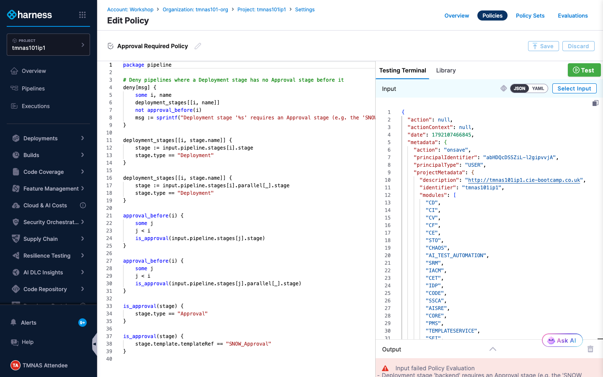

5. Select the **Policy Sets** tab, find **Approval Required Policy Set** and toggle **Enforced** on

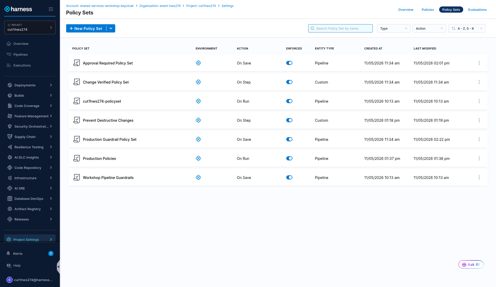

---

### Step 2: Governance in Action
1. Open your pipeline in Pipeline Studio
2. Make a small change (for example, add a tag to the pipeline) and click **Save**
3. Note that the save is blocked by the **Approval Required Policy**. Let's fix it!

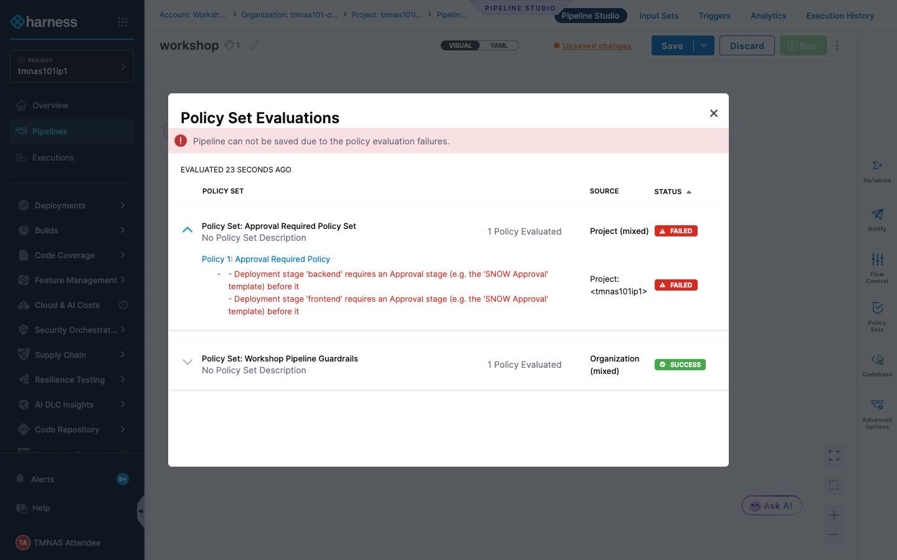

---

### Step 3: Add the ServiceNow Approval Stage
1. Hover before the **frontend** stage and click the **+** icon to add a new stage
2. Click **Use template**, select the **SNOW Approval** template and click **Use Template**

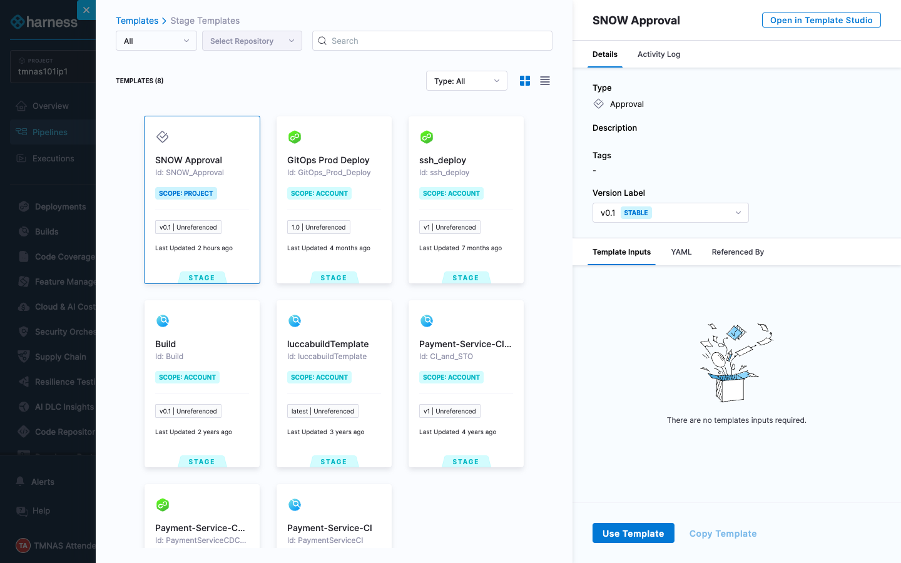

3. Configure the stage as follows and click **Set Up Stage**

| Input      | Value     | Notes |
| ---------- | ----------------------  | ----- |
| Stage Name | <pre>`ServiceNow Approval`</pre>| The name must match exactly. The close templates reference this stage to find the change number |

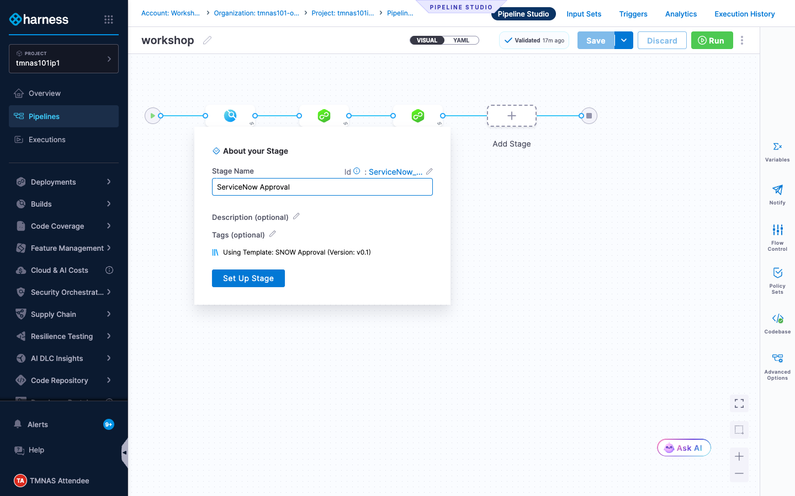

4. The template is pre-configured, so there are no inputs to fill in. Toggle **Overview** to see its two steps

| Step      | Type     | What it does |
| ---------- | ----------------------  | ----- |
| Create Ticket | ServiceNow Create | Raises a Normal change request with the pipeline name, execution number, triggering user, execution URL, justification, implementation, backout and test plans |
| Approval | ServiceNow Approval | Polls the change request every 30s. Approves when **State = Implement**, rejects when **State = Canceled** |

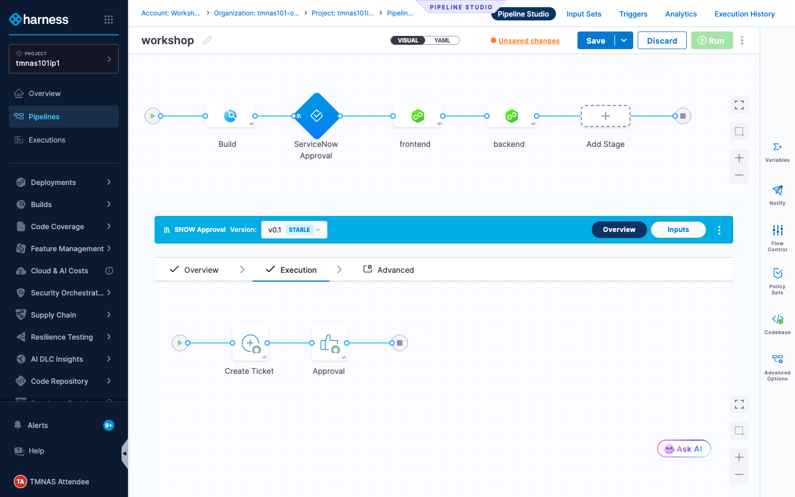

5. Click on each step to see how it is configured. As a template user you cannot change this enterprise-approved template, only the template administrator can. Note how expressions such as `<+pipeline.executionUrl>` and `<+execution.steps.Create_Ticket.ticket.ticketNumber>` populate the ticket and the approval

---

### Step 4: Close the Change on Success
1. Navigate to the **backend** stage and, after the last step of the execution, click **Add Step**, select **Use template** and choose **ServiceNow Close Ticket**

| Input      | Value     | Notes |
| ---------- | ----------------------  | ----- |
| Name | <pre>`Close Ticket`</pre>| Sets the change to **Closed** with close code **Successful** and links the execution in the close notes |

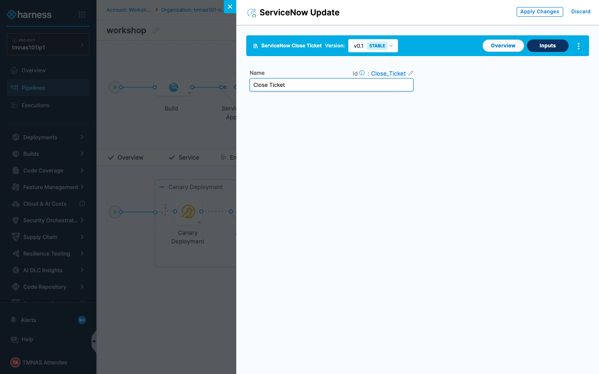

2. Click **Save**. No violations this time

---

### Step 5: Approve the Change as a Release Manager
1. Click **Run** to execute the pipeline

| Input      | Value     | Notes |
| ---------- | ----------------------  | ----- |
| Branch Name | <pre>`main`</pre>||

2. The pipeline pauses on the **ServiceNow Approval** stage. The change request has already been raised on your behalf and moved to **Scheduled**

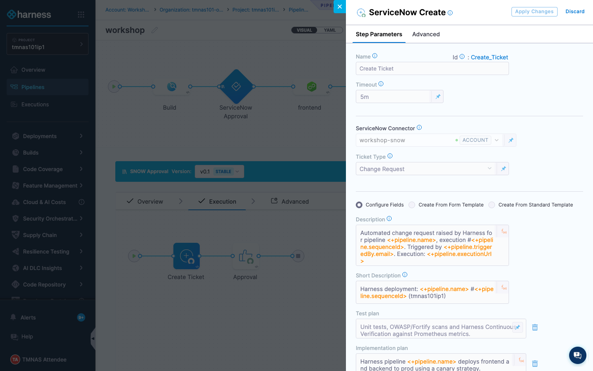

3. Click the **ServiceNow Approval** stage, select the **Approval** step and click the change number link in the step details to open the change request in a new tab
4. Log in to the ServiceNow sandbox at https://ven03172.service-now.com with the credentials provided by your instructor. Review the metadata the pipeline added to the change, then click **Implement** in the top right corner

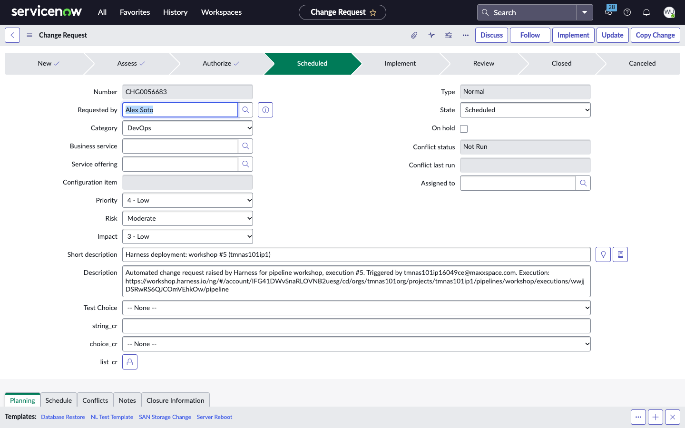
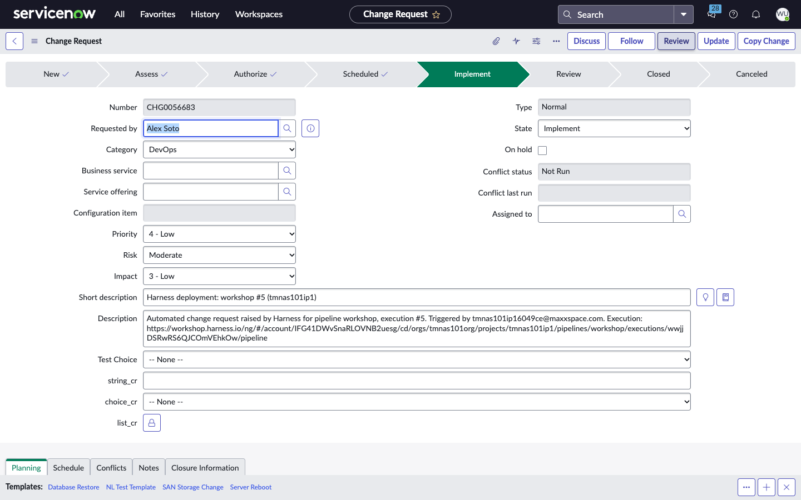

5. Switch back to Harness and watch the pipeline continue once the approval criteria are met. Approve the Harness Approval steps from Lab 10 as they come up. When the backend stage completes, **Close Ticket** closes the change as **Successful**

> [!TIP]
> The execution page doesn't always update on its own. If a step looks stuck, refresh the page.

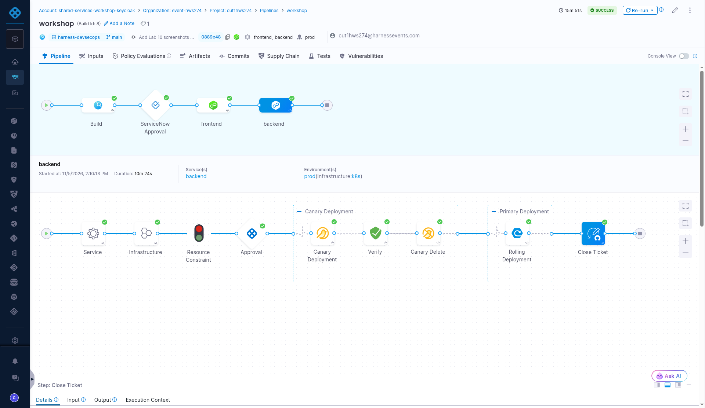
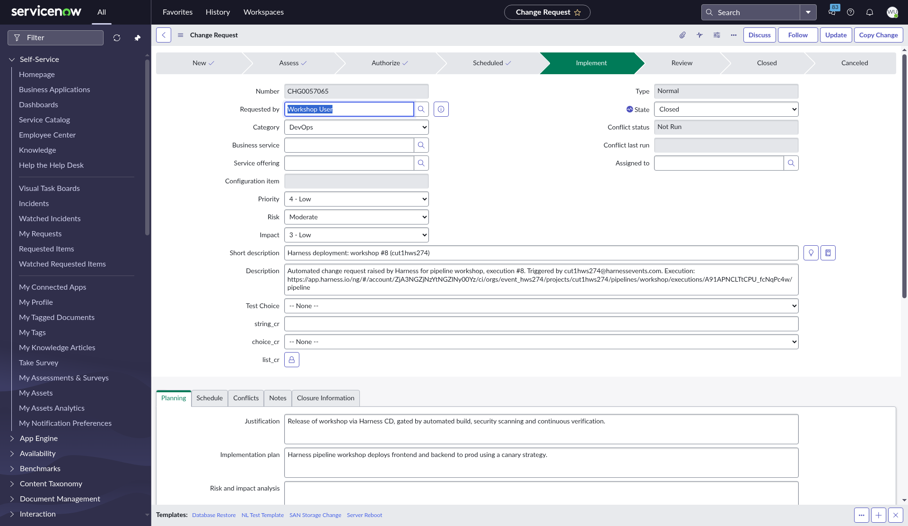

---

### Bonus Activities
- Run the pipeline again and this time **Cancel** the change in ServiceNow. Observe how the pipeline is rejected before anything is deployed to production
- What happens to the change if the release fails after it was approved? See Lab 13

---

## Value Callouts

| Aspect | Description |
| :--- | :--- |
| **Compliance as Code** | Change policy is enforced on every pipeline save, not by reviewing pipelines by hand. |
| **Zero Change Paperwork** | The pipeline raises the change request with full release metadata, so developers never fill in a change form. |
| **Auditable Trail** | Every release links its change request to the execution, from approval to closure. |
