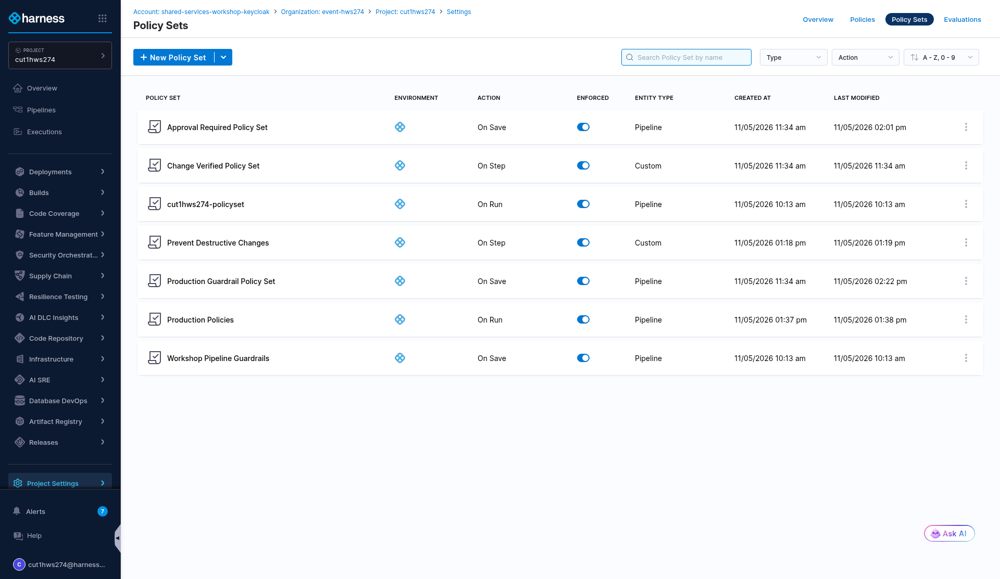
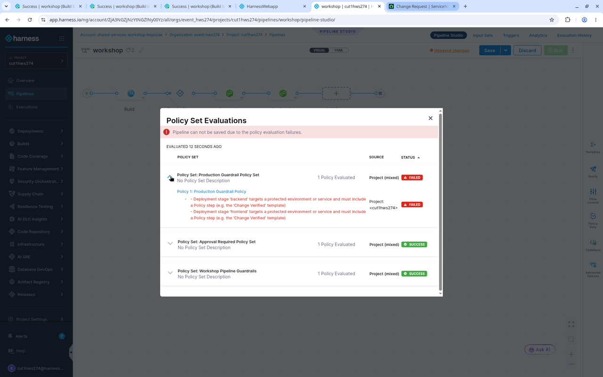
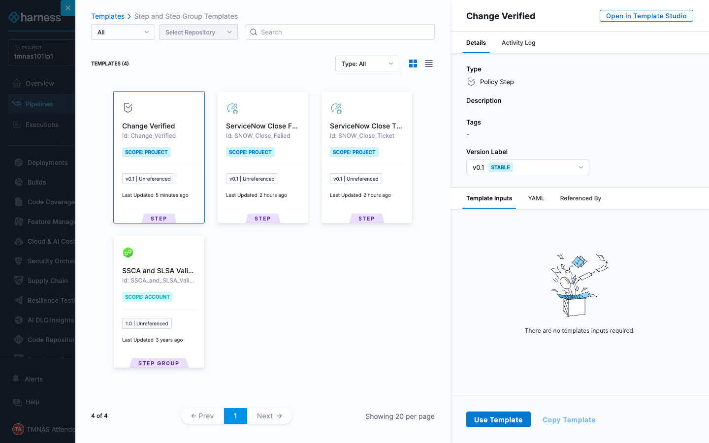
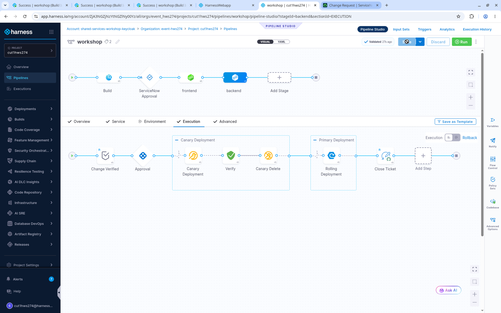
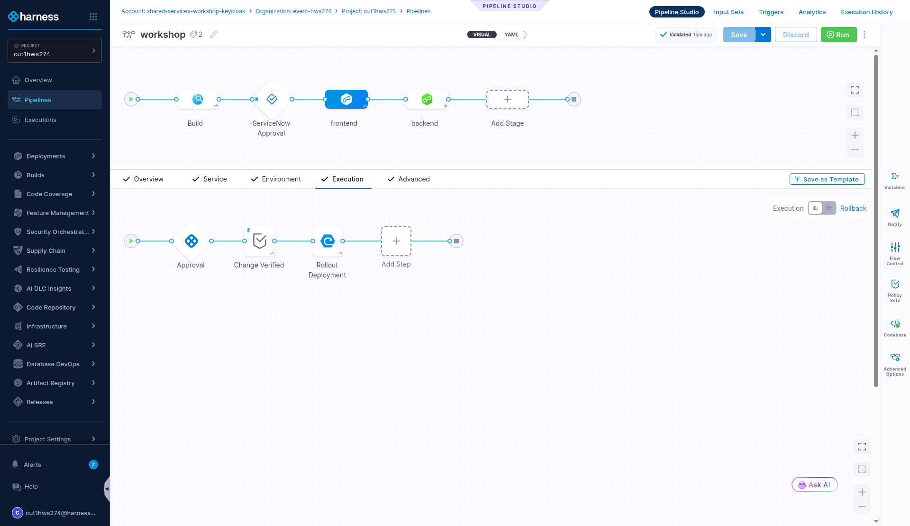
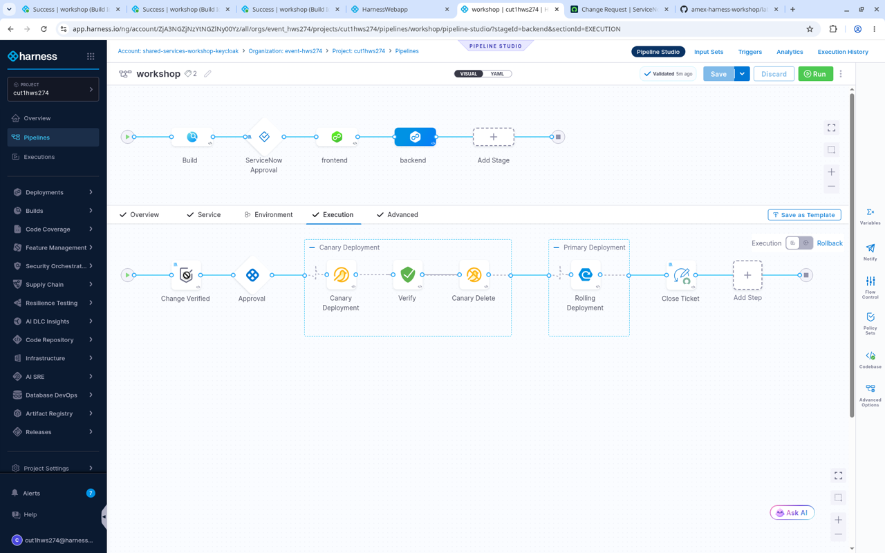
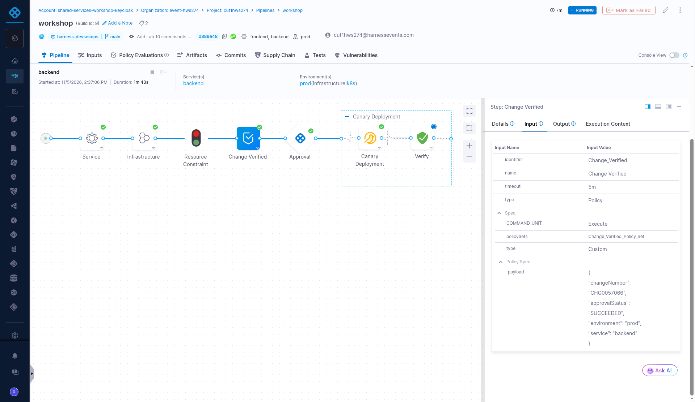
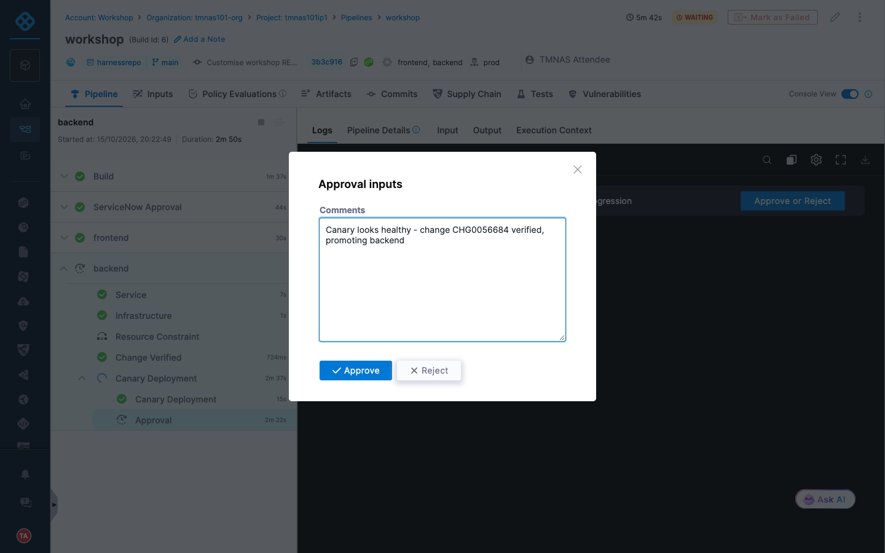
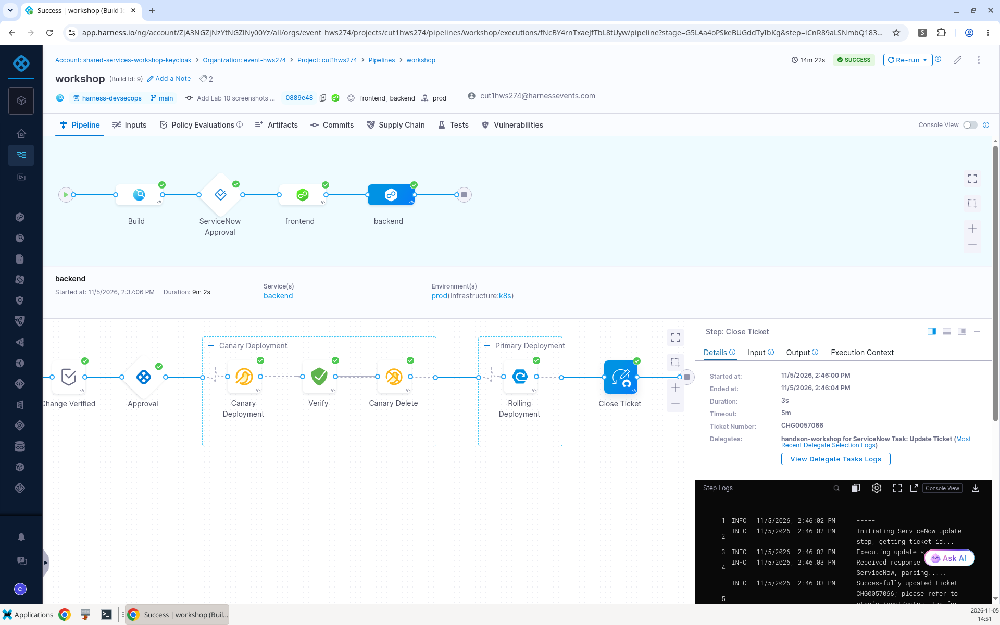

# Lab 12: Production Guardrails

## Key Outcomes
- Write guardrails that target specific environments and services
- Combine design-time (**On Save**) and runtime (**On Step**) policies
- Verify ServiceNow change details right before a production rollout

## Overview
An approval stage at the front of the pipeline is a good start, but production is special. In this lab the user enforces a policy that says *any deployment to the **prod** environment, or of the **backend** service, must include a policy check*, then adds a **Change Verified** policy step that confirms at runtime that the release is backed by an approved ServiceNow change.

---

## Walkthrough

### Step 1: Enforce the Production Guardrail
1. From the secondary menu, select **Project Settings** and select **Policies**
2. Select the **Policies** tab and open **Production Guardrail Policy**. Review the rego

| Rule | What it does |
| :--- | :--- |
| `protected_environments := {"prod"}` | Environments that need a policy check |
| `protected_services := {"backend"}` | Services that need a policy check, in any environment |
| `deny[msg]` | Fails any Deployment stage that targets a protected environment or service and has no step of type **Policy** |

3. Select the **Policy Sets** tab, find **Production Guardrail Policy Set** and toggle **Enforced** on



4. Open your pipeline in Pipeline Studio, make a small change and click **Save**. The save is blocked for **both** stages: frontend deploys to **prod**, and backend is a protected service




---

### Step 2: Add the Change Verified Step
The **Change Verified** step template is a **Policy** step that evaluates the **Change Verified Policy Set** (On Step) with this payload:

```json
{
  "changeNumber": "<+pipeline.stages.ServiceNow_Approval.spec.execution.steps.Create_Ticket.ticket.ticketNumber>",
  "approvalStatus": "<+pipeline.stages.ServiceNow_Approval.status>",
  "environment": "<+env.identifier>",
  "service": "<+service.identifier>"
}
```

The **Change Verified Policy** denies the step if the change number doesn't start with `CHG`, or if the ServiceNow Approval stage did not succeed.

1. Open the **frontend** stage and go to **Execution**. Hover **before** the **Rollout Deployment** step, click **+**, select **Use template** and choose **Change Verified**



| Input      | Value     | Notes |
| ---------- | ----------------------  | ----- |
| Name | <pre>`Change Verified`</pre>||




2. Open the **backend** stage, go to **Execution** and add the same template **before** the **Canary Deployment** step group



3. Click **Save**. The Production Guardrail is satisfied this time

---

### Step 3: Run the Pipeline
1. Click **Run** and approve the change in ServiceNow (**Implement**) as in Lab 11
2. When each deployment stage starts, click the **Change Verified** step. The logs show the policy set passed. Select the **Input** tab to see the change number, approval status, environment and service that were evaluated



3. Approve the Harness Approval steps. The pipeline completes and **Close Ticket** closes the change




---

### Bonus Activities
- Add `"qa"` to `protected_environments` in the Production Guardrail policy. Which of your stages would be affected?
- Open the **Policy Evaluations** tab of the execution to see every policy that was evaluated, both On Save and On Step

---

## Value Callouts

| Aspect | Description |
| :--- | :--- |
| **Targeted Guardrails** | Policies apply to the environments and services that matter, without slowing down everything else. |
| **Design-time and Runtime** | On Save policies shape the pipeline; On Step policies check real values right before the rollout. |
| **Evidence for Auditors** | The evaluated change number and approval status are stored with every execution. |
