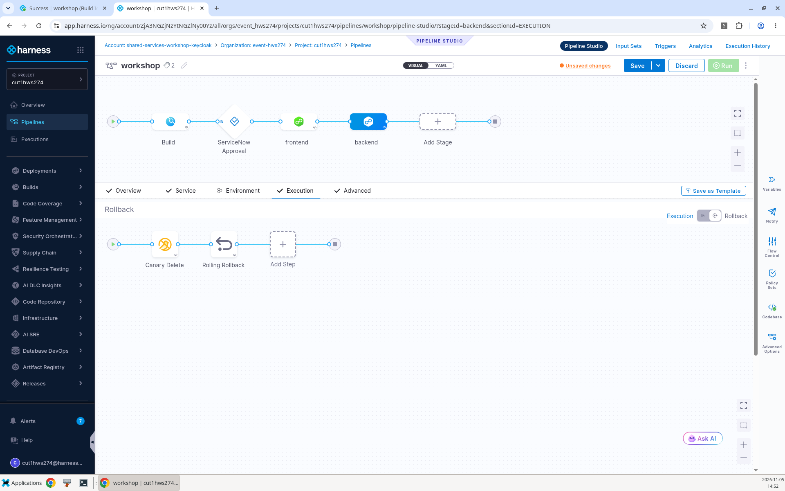
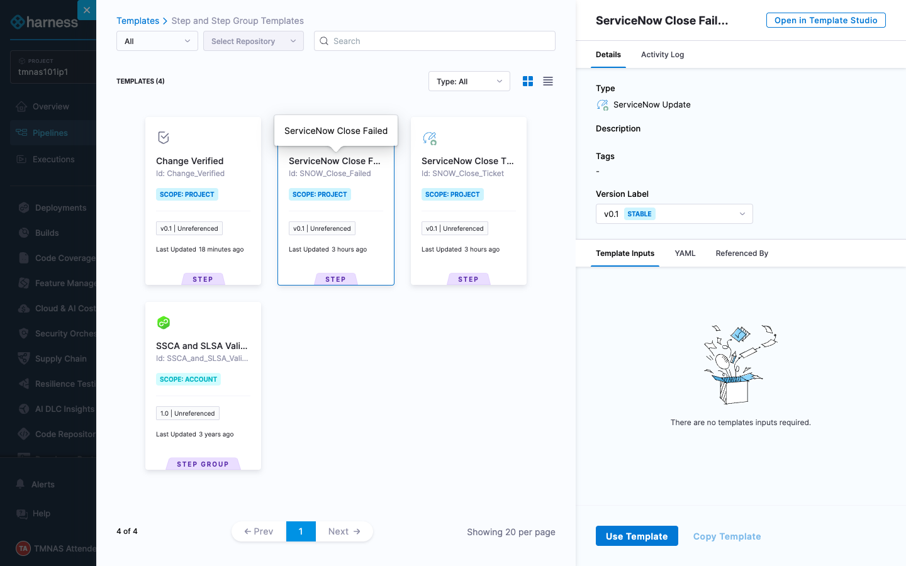
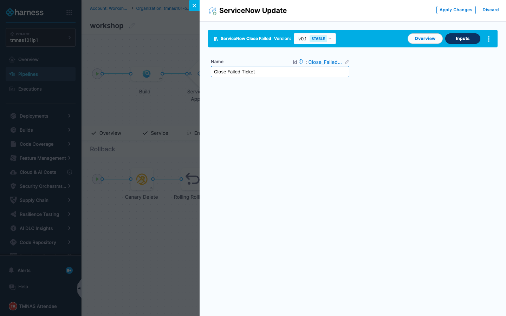
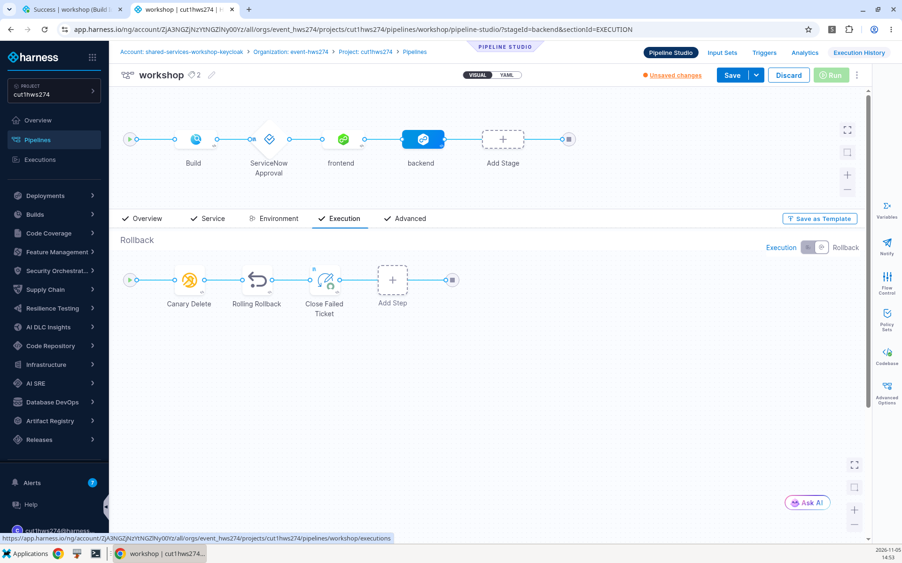
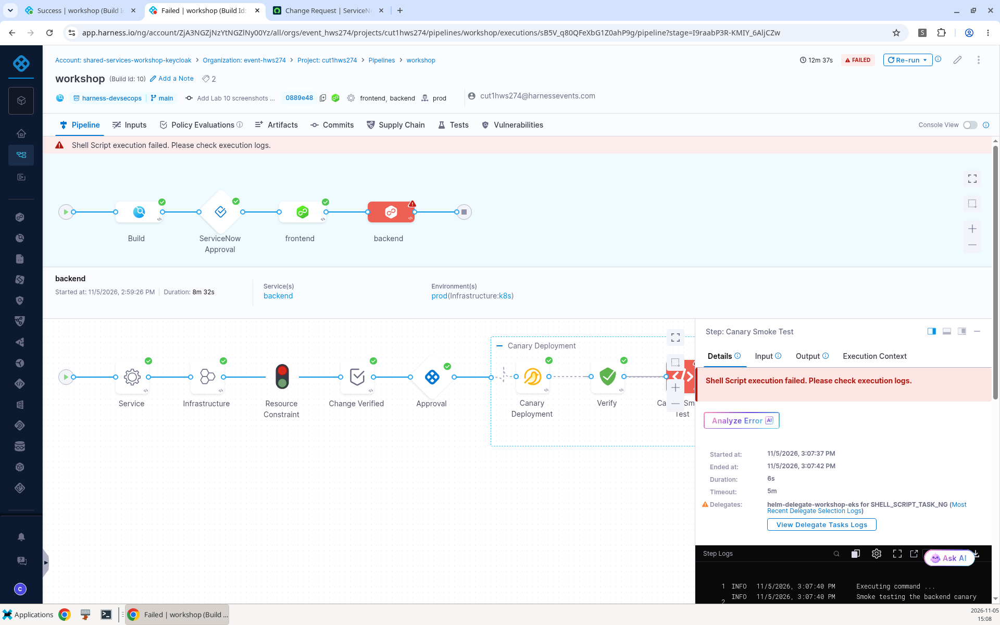
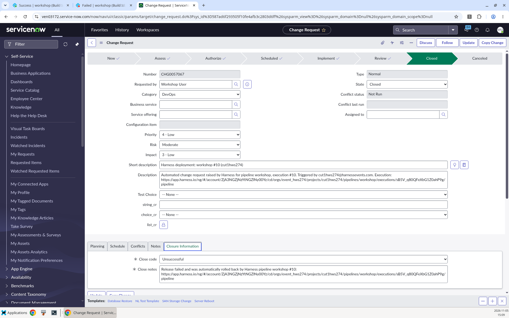
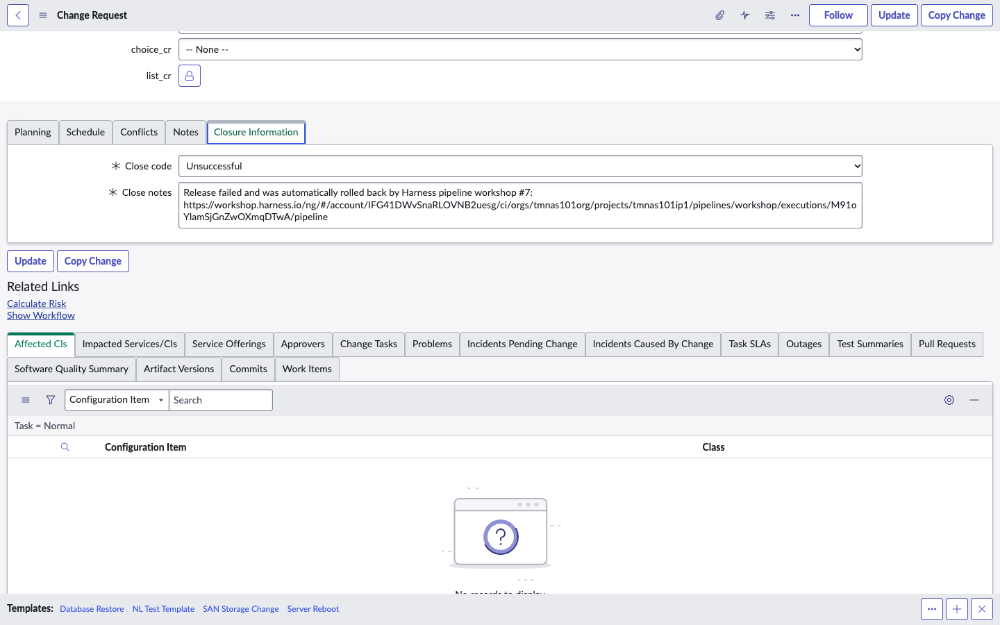

# Lab 13: Automated Rollback

## Key Outcomes
- Add a post-deploy smoke test that gates the release after the canary is verified
- Roll back automatically when a release fails
- Record the failed release in ServiceNow

## Overview
A canary only protects users if a failing release is stopped before it reaches them. In this lab the user adds a post-deploy smoke test, the **Canary Smoke Test**, to the backend stage, after **Verify** has checked the canary's metrics. It's a check that runs right after a deployment and calls the new version's endpoints, so a broken release fails the pipeline instead of reaching users. The smoke test is set up to fail, so Harness rolls the stage back on its own and the release never reaches the stable deployment. A rollback step then closes the ServiceNow change as **Unsuccessful**, so the change record always reflects what really happened.

---

## Walkthrough

### Step 1: Add a Post-Deploy Smoke Test
> [!NOTE]
> **Can Harness run a smoke test after a deploy?** Yes. Any Shell Script, Run or HTTP step placed after a deployment step can call the app's health or release endpoint and assert the response. With a **Rollback Stage** failure strategy, a failed check rolls the release back automatically. This lab uses a pre-built template that does exactly that against the canary.

Your project has been provisioned with a **Canary Smoke Test** step template.

1. From the module selection menu select **Continuous Delivery & GitOps** and open your pipeline
2. In the **backend** stage, inside the **Canary Deployment** step group, hover between **Verify** and **Approval**, click **+**, select **Use template** and choose **Canary Smoke Test**

| Input      | Value     | Notes |
| ---------- | ----------------------  | ----- |
| Name | <pre>`Canary Smoke Test`</pre>||

3. Click **Apply Changes**. The template is a **Shell Script** step that runs on the delegate. It finds the canary pod in your `devsecops-<project_id>` namespace and smoke tests it, and its failure strategy is **Rollback Stage**, so a failed smoke test rolls the stage back without waiting for a human. The smoke test is set up to always fail, so you can see a rollback without breaking the application

---

### Step 2: Close the Change on Failure
1. In the **backend** stage **Execution**, toggle the **Rollback** view in the top right corner



2. Click the **+** after the last rollback step, select **Use template** and choose **ServiceNow Close Failed**



| Input      | Value     | Notes |
| ---------- | ----------------------  | ----- |
| Name | <pre>`Close Failed Ticket`</pre>| Sets the change to **Closed** with close code **Unsuccessful** and links the failed execution in the close notes |



3. Template steps have no **Advanced** tab, so set the conditional execution in YAML. Switch the Pipeline Studio to **YAML**, find the `Close_Failed_Ticket` step in the backend stage's `rollbackSteps` and add `when` at the same level as `name` and `identifier`:

```yaml
- step:
    name: Close Failed Ticket
    identifier: Close_Failed_Ticket
    template:
      templateRef: ...   # leave as generated
    when:
      stageStatus: All
```

`stageStatus: All` means **Always execute this step**, so the change is closed even if an earlier rollback step fails. Switch back to **Visual**
4. Apply the changes and **Save** the pipeline




---

### Step 3: Run and Review
1. Click **Run**, approve the change in ServiceNow as in Lab 11 and approve the Harness Approval steps
2. Once the canary is deployed, **Verify** analyses its Prometheus metrics over a 5 minute window and passes. **Canary Smoke Test** then fails with `FAILED: the canary returned HTTP 500 from /api/orders`
3. Harness rolls back the stage before anyone is asked to approve it: **Canary Delete**, **Rolling Rollback** and then **Close Failed Ticket**. The release never reaches the stable deployment



4. Open the change request in ServiceNow. It is **Closed** with close code **Unsuccessful**, and the **Closure Information** tab links to the failed execution

> [!TIP]
> The execution page doesn't always update on its own. If a step looks stuck, refresh the page.




---

## Value Callouts

| Aspect | Description |
| :--- | :--- |
| **Small Blast Radius** | Only the canary is exposed to the failing release, so users stay on the healthy stable version. |
| **Self-healing Releases** | A failed check rolls the release back without human intervention. |
| **Accurate Change Records** | ServiceNow always reflects the real outcome of a release, including automated rollbacks. |
