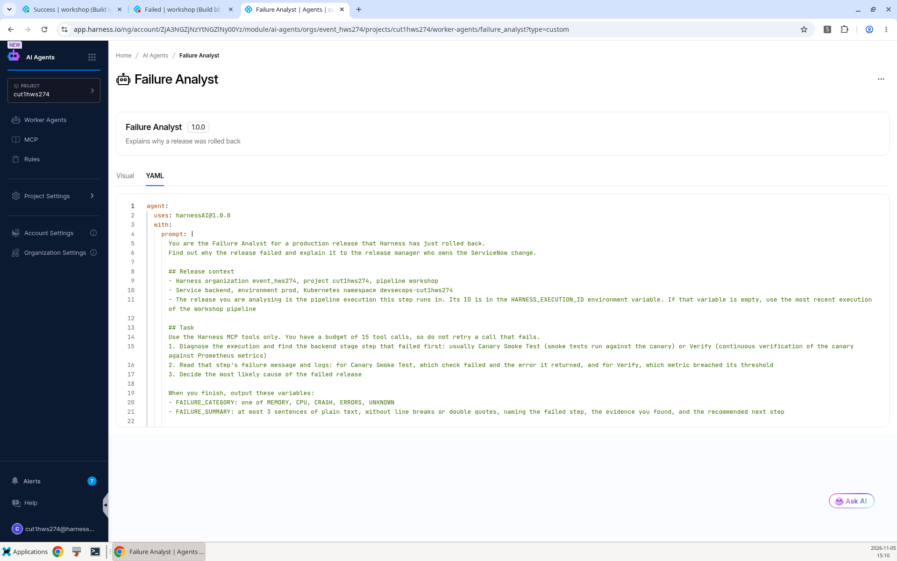
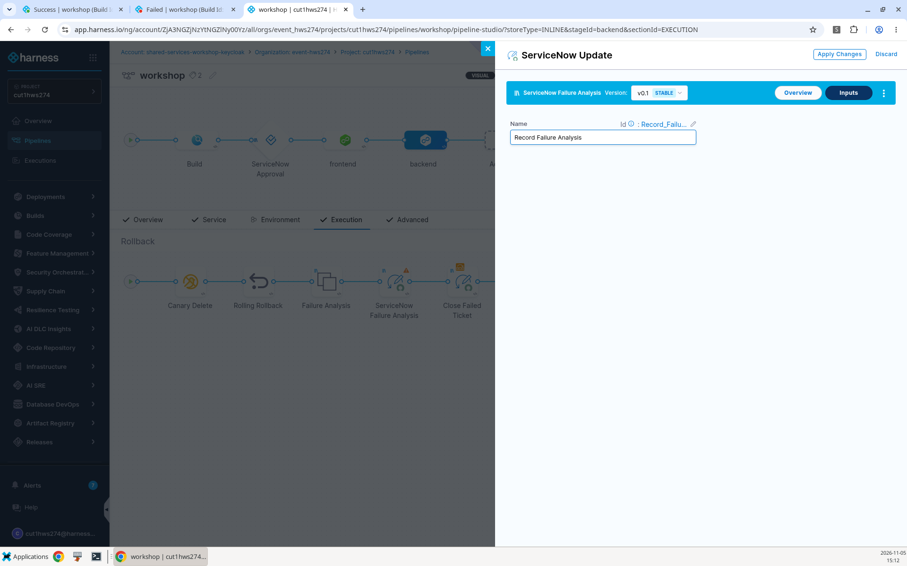
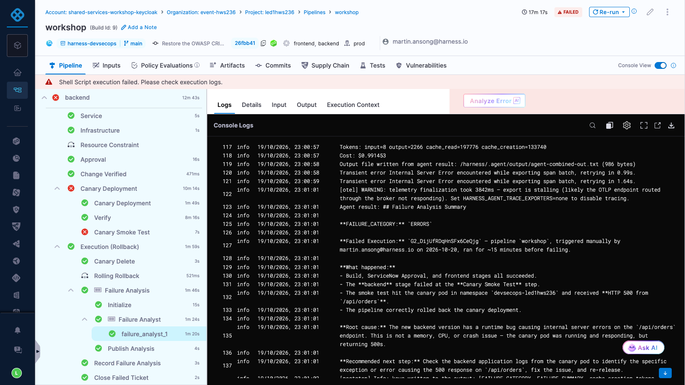
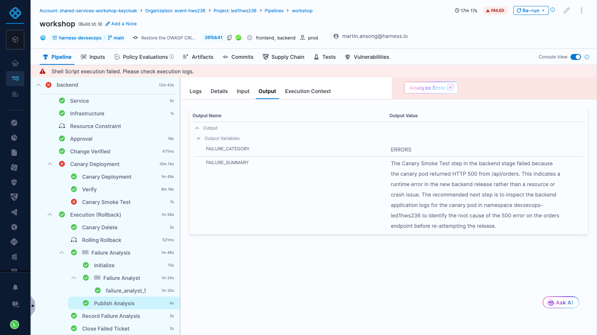
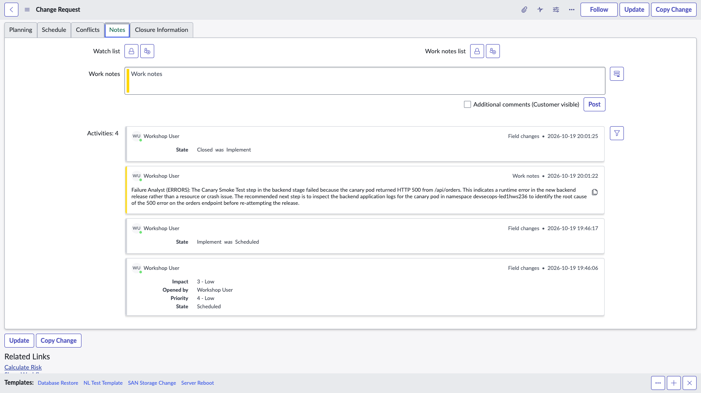

# Lab 14: AI Failure Analysis with a Worker Agent

## Key Outcomes
- Understand how a custom Harness Worker Agent is defined
- Run an AI agent inside the pipeline when a release rolls back
- Turn the agent's findings into an audited ServiceNow change record

## Overview
In Lab 13 Harness rolled the release back and closed the change as **Unsuccessful**, but the release manager still has to work out *why* it failed. In this lab the user creates a **Failure Analyst** Worker Agent that runs in the rollback steps, reads the failed step details and logs through the Harness MCP tools and publishes a root cause summary while the execution is still running. The agent is read-only: a ServiceNow step writes its findings to the change request's work notes, so every action on the change record still comes from the pipeline.

---

## Walkthrough

> [!IMPORTANT]
> **Organizer setup:** before the event, grant attendees read/use access (`core_connector_view` and `core_connector_access`) on the model connector the **Failure Analyst** agent template uses. Without connector access, the run is rejected with `Failed to expand Agent step 'Failure_Analyst' ... Missing permission core_connector_access`.
>
> **LLM gateway access:** for this workshop, assign the gateway-only account role `workshop_llm_gateway_user` (`ai_llmgateway_access` on **LLM_GATEWAY**) to each attendee **USER**, at **account scope**, using the Harness-managed `_all_account_level_resources` resource group. Use one assignment per attendee, **not All Account Users**. A project-level grant or an empty custom resource group does not authorize the account gateway check during Agent template expansion and can cause a 403 before execution. Connector access is separate. Verify with an attendee-started run before the event; these are organizer prerequisites, not attendee RBAC changes.

### Step 1: Review the Failure Analyst Agent
Your project has been provisioned with a **Failure Analyst** Worker Agent (identifier `failure_analyst`).

1. From the module selection menu select **AI Agents** and then **Worker Agents**
2. Select the **Custom** tab and open **Failure Analyst**
3. Switch to the **YAML** tab and compare the definition with the reference below



The complete, reusable definition is in [`reference/agents/failure-analyst.yaml`](../reference/agents/failure-analyst.yaml). Replace `<account_id>`, `<org_id>` and `<project_id>` when provisioning it. The agent:

- Reads the current execution ID from `HARNESS_PLAN_EXECUTION_ID` or `HARNESS_EXECUTION_ID`, never from the latest execution list
- Fetches the full execution graph and finds the failed backend leaf step and its `failureInfo.message`
- Downloads that step's command-unit log using signed-download mode, then reads the JSONL entries from the ZIP
- Returns `FAILURE_CATEGORY` and a concise `FAILURE_SUMMARY`, and writes them to `/harness/.agent/output/task_output.json`

> [!IMPORTANT]
> **Do not call full-execution diagnose during rollback.** The execution is still Running and diagnose rejects it. Use execution details with `render_full_graph=true` and the failed step's exact `logBaseKey`. The buffered log endpoint can return 404 on this deployment; use `execution_log` with `params.return_download_url: true`. If MCP returns `/proxy/app.harness.io/storage/...`, normalize that exact prefix to `https://app.harness.io/storage/...` before downloading without authentication headers. Preserve the signed query unchanged and never log the signed URL.

4. Close the agent without making changes

> [!NOTE]
> Agent instructions only resolve `<+inputs.*>`, `<+trigger.*>` and `<+secret.getValue()>` expressions, so your organization and project were filled in when the agent was provisioned, and the agent reads the current execution ID from `HARNESS_PLAN_EXECUTION_ID` or `HARNESS_EXECUTION_ID`. The agent talks to Harness through the built-in Harness MCP server, and `account.harnessAnthropic` is the Harness-managed model connector, so no API keys are needed.

---

### Step 2: Run the Agent on Rollback
1. From the module selection menu select **Continuous Delivery & GitOps** and open your pipeline
2. In the **backend** stage **Execution**, toggle the **Rollback** view
3. Hover between **Rolling Rollback** and **Close Failed Ticket**, click **+**, select **Use template** and choose **Failure Analysis**

| Input      | Value     | Notes |
| ---------- | ----------------------  | ----- |
| Name | <pre>`Failure Analysis`</pre>| Keep this name, the ServiceNow template reads the agent's output from it |

4. Click **Apply Changes**. The template is a containerized step group on **k8s-prod** in your `devsecops-<project_id>` namespace, so the agent runs next to the application. It holds two steps: the **Agent** step **Failure Analyst**, using the stable version of the agent, and a **Run** step **Publish Analysis** that reads the explicit JSON result (or parses the runner's `agent-combined-out.txt` final-answer file) and exports **FAILURE_CATEGORY** and **FAILURE_SUMMARY** as output variables, because Agent step outputs are only exported in CI stages. The publisher normalizes the summary to plain text and falls back to the failed step's error message if no agent summary is available. Its failure strategy is **Ignore** so the rollback always finishes, even if the agent can't
5. After the **Failure Analysis** step group, click **+**, select **Use template** and choose **ServiceNow Failure Analysis**

| Input      | Value     | Notes |
| ---------- | ----------------------  | ----- |
| Name | <pre>`Record Failure Analysis`</pre>| Adds the agent's category and summary to the change request's work notes |

6. Template steps have no **Advanced** tab, so set the conditional execution and failure strategy in YAML. Switch to **YAML**, find the `Record_Failure_Analysis` step in `rollbackSteps` and add the following at the same level as `name` and `identifier`:

```yaml
    when:
      stageStatus: All
    failureStrategies:
      - onFailure:
          errors:
            - AllErrors
          action:
            type: Ignore
```

This means **Always execute this step**, with **Ignore** for **All Errors**, so the work note is recorded even if the agent fails and **Close Failed Ticket** still runs. Switch back to **Visual**
7. Apply the changes and **Save** the pipeline. The rollback steps are now **Canary Delete**, **Rolling Rollback**, **Failure Analysis**, **Record Failure Analysis** and **Close Failed Ticket**

> [!IMPORTANT]
> **Keep Failure Analysis and Record Failure Analysis sequential.** The visual editor can place them in the same parallel block as Rolling Rollback. Move Record Failure Analysis after the completed Failure Analysis group; otherwise its output expressions evaluate too early and the work note becomes `Failure Analyst (null): null`. See [`reference/lab14-rollback-steps.yaml`](../reference/lab14-rollback-steps.yaml) for the correct order, plus the [Failure Analysis](../reference/templates/failure-analysis.yaml) and [ServiceNow Failure Analysis](../reference/templates/servicenow-failure-analysis.yaml) reference templates.



---

### Step 3: Run and Review
1. Click **Run**, approve the change in ServiceNow and approve the Harness Approval steps as before
2. The **Canary Smoke Test** from Lab 13 fails and Harness rolls the stage back
3. Expand the **Failure Analysis** step group, then expand **Failure Analyst** and open **failure_analyst_1**. The logs show the agent finding the failed leaf step in the current execution graph, reading its command-unit log and finishing with its failure analysis summary



4. Open **Publish Analysis**: its **Output** tab shows **FAILURE_CATEGORY** and **FAILURE_SUMMARY**, which the **Record Failure Analysis** step reads with `<+pipeline.stages.backend.spec.execution.rollbackSteps.Failure_Analysis.steps.Publish_Analysis.output.outputVariables.FAILURE_SUMMARY>`



For this exercise, verify that the summary names **Canary Smoke Test** and the evidence **HTTP 500 from `/api/orders`**, not `null` or `UNKNOWN`. If log retrieval failed, the publisher still records the failed step error, but that is incomplete evidence rather than a verified root cause.

5. Open the change request in ServiceNow. The **Notes** tab has a work note from the Failure Analyst with the root cause, and the change is **Closed** with close code **Unsuccessful**



---

## Value Callouts

| Aspect | Description |
| :--- | :--- |
| **Faster Root Cause** | The release manager gets an explanation with evidence the moment a release fails, not hours later. |
| **Agents Inside the Pipeline** | Worker Agents run in the same governed pipeline as every other step, with the same RBAC, audit trail and failure strategies. |
| **Human-readable Change Records** | ServiceNow captures why a change failed, not just that it did. |
| **Safe by Design** | The agent is read-only; only the pipeline's ServiceNow step changes the change record, and a failed agent never blocks the rollback. |
