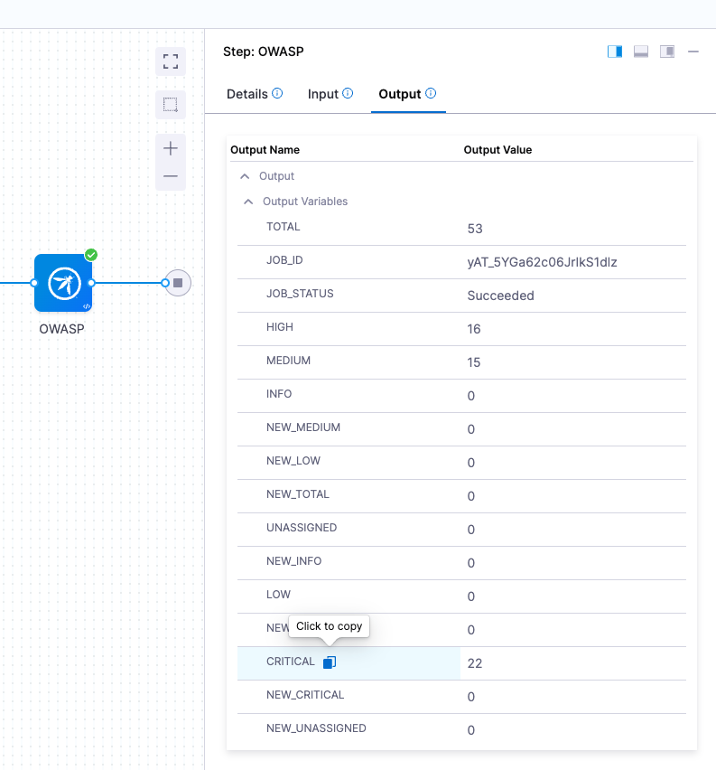

# Lab 15: Governance - Policy as Code (Advanced)

## Key Outcomes
- Block critical CVEs from reaching production  
- Enforce security policies during runtime  

## Overview
In this lab, the user creates an advanced policy that blocks deployments when critical vulnerabilities are detected by security scanners like OWASP.

---

## Walkthrough

> [!NOTE]
> This lab builds on the pipeline from Labs 10 to 13. To reach the new policy step, a run still passes the earlier gates: the **ServiceNow Approval** stage (move the change to **Implement** in ServiceNow), the frontend **Approval** step and the **Change Verified** step. Have ServiceNow open before you run.

### Step 1: Create a Policy to Block Critical CVEs
1. From the secondary menu, select **Project Settings**
2. Select **Policies**
3. Click the **Policies** tab
4. Click **+ New Policy**

| Input      | Value     | Notes |
| ---------- | ----------------------  | ----- |
| Name | <pre>`Runtime OWASP CVEs`</pre>||

5. Click **Apply**
6. Set the Rego policy to the following and click **Save**

```opa
package pipeline_environment
deny[sprintf("Node OSS Can't contain any critical vulnerability '%d'", [input.NODE_OSS_CRITICAL_COUNT])] {  
   input.NODE_OSS_CRITICAL_COUNT != 0
}
```

---

### Step 2: Create a Policy Set
1. Select the **Policy Sets** tab
2. Click **+ New Policy Set** and configure as follows:

| Input      | Value     | Notes |
| ---------- | ----------------------  | ----- |
| Name | <pre>`Criticals Not Allowed`</pre>||
| Entity Type | Custom ||
| Event Evaluation | On Step ||
| Policy to Evaluate | Runtime OWASP CVEs ||

3. Click **Apply**
4. Click **Finish**
5. Toggle the **Enforced** button

---

### Step 3: Add Policy to Pipeline
1. Open your pipeline
2. The OWASP step in the **Build** stage publishes the number of critical vulnerabilities it found as the **CRITICAL** output variable. You can see it on the step's **Output** tab of a previous execution. Its expression is



```
<+pipeline.stages.Build.spec.execution.steps.OWASP.output.outputVariables.CRITICAL>
```

3. Select the **frontend** stage
4. Before the **Rollout Deployment** step, add a **Policy** type step

| Input      | Value     | Notes |
| ---------- | ----------------------  | ----- |
| Name | <pre>`Policy - No Critical CVEs`</pre>||
| Entity Type | Custom ||
| Policy Set | Criticals Not Allowed | Make sure to select the Project tab |
| Payload | <pre>`{"NODE_OSS_CRITICAL_COUNT": <+pipeline.stages.Build.spec.execution.steps.OWASP.output.outputVariables.CRITICAL>}`</pre>| The OWASP **CRITICAL** output variable from the previous step |

5. Click **Apply Changes**

---

### Step 4: Test the Policy
1. Save the pipeline and execute. Move the change to **Implement** in ServiceNow and approve the frontend **Approval** step when prompted
2. Note that the pipeline fails at the policy evaluation step due to critical vulnerabilities being found by OWASP

> [!TIP]
> The change request raised for this run stays in **Implement**. Cancel it in ServiceNow, or add the **ServiceNow Close Failed** template to the frontend rollback steps as you did for the backend in Lab 13.

---

### Step 5: Clean Up
The **Policy - No Critical CVEs** step fails every run while OWASP reports critical vulnerabilities, so remove it once you've seen it work:

1. Open the pipeline, select the **frontend** stage and delete the **Policy - No Critical CVEs** step
2. Click **Save**
3. In ServiceNow, cancel any change request from this lab that's still open
4. Optionally, toggle **Enforced** off on the **Criticals Not Allowed** policy set

---

## Value Callouts

| Aspect | Description |
| :--- | :--- |
| **Security by Default** | Critical vulnerabilities are automatically blocked from production. |
| **Runtime Enforcement** | Policies evaluate real scan results, not just configuration. |
| **Risk Mitigation** | High-severity issues are caught before deployment, reducing attack surface. |
| **Compliance Automation** | Security policies are enforced consistently across all pipelines without manual oversight. |
