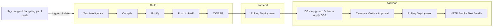

# Reference pipeline (Labs 1–9)

Catch-up artifacts for the **single `workshop` pipeline** design:

| File | Purpose |
| --- | --- |
| [`workshop-pipeline.yaml`](workshop-pipeline.yaml) | Build (HAR) → frontend → backend (DB3 apply + canary + `/health` smoke test) |
| [`services/frontend.yaml`](services/frontend.yaml) | Frontend service with HAR artifact source in the project `<project_id>-workshop` registry |
| [`services/backend.yaml`](services/backend.yaml) | Backend service using the organizer-built image in the account-level `workshop-shared` HAR registry |
| [`backend-image-pipeline.yaml`](backend-image-pipeline.yaml) | One-off organizer pipeline that builds `backend/Dockerfile` and pushes it to `workshop-shared` |
| [`terraform/backend-service/`](terraform/backend-service/) | Superseded: provisioning Terraform now sets the backend artifact; kept for reference |
| [`ORGANIZER-SETUP.md`](ORGANIZER-SETUP.md) | Pre-provision HAR registries and related event setup |

## Lab 14 rollback analysis

These snippets are for the end of Labs 13–14, not the Labs 1–9 starting pipeline. Replace the account, organization and project placeholders before provisioning.

| File | Purpose |
| --- | --- |
| [`agents/failure-analyst.yaml`](agents/failure-analyst.yaml) | Worker Agent prompt and structured result contract |
| [`templates/failure-analysis.yaml`](templates/failure-analysis.yaml) | Containerized agent and robust Publish Analysis step |
| [`templates/servicenow-failure-analysis.yaml`](templates/servicenow-failure-analysis.yaml) | ServiceNow work note using the completed publisher outputs |
| [`lab14-rollback-steps.yaml`](lab14-rollback-steps.yaml) | Sequential rollback order; analysis must finish before its work note is recorded |
