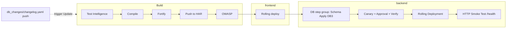

# Reference pipeline (Labs 1–9)

Catch-up artifacts for the **single `workshop` pipeline** design:

| File | Purpose |
| --- | --- |
| [`workshop-pipeline.yaml`](workshop-pipeline.yaml) | Build (HAR) → frontend → backend (DB3 apply + canary + `/health` smoke test) |
| [`services/frontend.yaml`](services/frontend.yaml) | Frontend service with HAR artifact source |
| [`services/backend.yaml`](services/backend.yaml) | Backend service using the organiser-built image in the org-scoped `workshop-shared` HAR registry |
| [`backend-image-pipeline.yaml`](backend-image-pipeline.yaml) | One-off organiser pipeline that builds `backend/Dockerfile` and pushes it to `workshop-shared` |
| [`ORGANISER-SETUP.md`](ORGANISER-SETUP.md) | Pre-provision HAR registry and related event setup |

